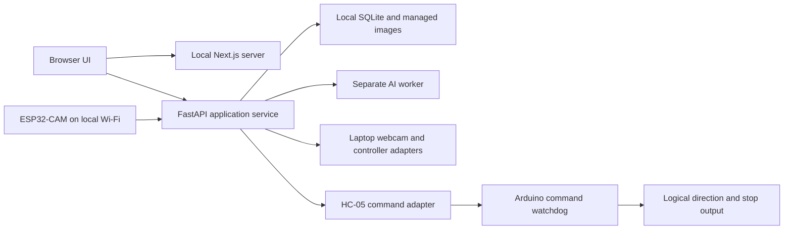

# Lost and Found — Architecture Decision Record

## Authority and design paradigm

This is the canonical technical decision record. Alisa adopted AD-1–AD-14 during the guided architecture session on 2026-11-05 and approved AD-15 on 2026-11-06. Version 1.3 implements the authorized 2026-11-13 scope cleanup, amending AD-3/AD-5/AD-14 and the acceptance evidence boundary under [PRD v1.3](PRD.md), section 9. Earlier adoption dates do not imply prior approval of these amendments. The PRD owns scope and acceptance. This record governs technical invariants; [TRD v1.3](TRD.md) derives the implementation contracts. A conflict requires an explicit upstream revision, never an implicit override. Documentation finalization does not establish device compatibility or measured performance.

Version 1.4 adds the directory design selected by Alisa on 2026-11-13: one repository and coordinated release, `backend/` and `frontend/`, lean feature-based backend modules, and the recommended feature-based Next.js App Router frontend. This is an additive code-organization decision under AD-2/AD-4/AD-13; the existing process split, authority rules and qualification gates still apply. The trees below describe the intended implementation. This revision creates no application folders or starter code.

Use a **layered modular application with one authoritative local service**. Next.js owns presentation. FastAPI owns application state and coordinates adapters for devices, AI and storage. AI runs in a separate worker process and cannot command motors or mutate records. Arduino owns the final command-expiry stop. Implementation contracts below these boundaries live in the TRD.



Arrows represent permitted request/data dependencies and end at firmware/logical interfaces. Next.js never writes the database or drives a device; only FastAPI accesses those adapters. Device and worker outputs are observations, not authoritative session mutations.

## Invariants and rules

### AD-1 — Local browser application [ADOPTED]

- **Binds:** All application units; NFR-1, NFR-3.
- **Prevents:** A remote backend or a native-only interface replacing the chosen surface.
- **Rule:** Run a browser interface and Python backend on the operator's Windows laptop. Complete searching works without internet after setup.

### AD-2 — Frameworks and responsibility split [ADOPTED]

- **Binds:** Frontend, backend, device and persistence units.
- **Prevents:** Competing owners of safety, session state or records.
- **Rule:** Use Next.js, React and TypeScript for presentation and FastAPI for the Python application service. Backend state and eligibility are authoritative. The browser sends actions and displays backend state; it never establishes Found or motor permission itself.

### AD-3 — Separate wireless command and video paths [ADOPTED; amended 2026-11-13]

- **Binds:** Communication adapters; FR-7, NFR-2.
- **Prevents:** Assuming the camera carries motor commands or Bluetooth carries live video.
- **Rule:** Commands travel through the HC-05 Bluetooth serial adapter to Arduino Uno firmware; ESP32-CAM video reaches the backend over existing local Wi-Fi. Configure selected endpoints and validate protocol compatibility at T2. Keep command and video failure handling independent. Fixed-desk multi-room coverage and timing require real-device integration evidence; a permitted wired connection must still meet that scope.

### AD-4 — Two local release services [ADOPTED]

- **Binds:** Frontend build, launcher and deployment.
- **Prevents:** Shipping a static-only frontend or requiring public hosting.
- **Rule:** Run a local Next.js Node server alongside FastAPI. Ship a production frontend build and locally installed runtime assets. The launcher supervises startup/shutdown; it cannot bypass readiness or automatically resume searching.

### AD-5 — Expiring motion permission [ADOPTED; amended 2026-11-13]

- **Binds:** Input, browser, backend and Arduino; FR-4–FR-8, FR-17, SM-2.
- **Prevents:** Continued or replayed motion after input, video, workspace or process failure.
- **Rule:** Permit movement only with fresh selected-mode input, live video and an operational focused/visible workspace. Browser loss, hidden tab/focus loss or required-path failure stops and pauses. Arduino independently expires commands. Recovery requires acknowledgment, restored readiness, explicit Resume and release/reapply of input. Verify software revocation, firmware expiry and logical stop output with measured timing and failure tests. The full wheel-stop target remains 0.5 seconds including loss detection and requires separate external integration measurement under SM-2; software tests alone cannot establish it or consume the entire allowance as a new software-only limit.

### AD-6 — Capability failure and interrupted evidence [ADOPTED]

- **Binds:** Session coordinator and history; UX G1–G3.
- **Prevents:** Automatic restart, invented confirmation or interpreting Stop as rejection.
- **Rule:** AI failure blocks Start or stops/pauses operation. Restart ends unfinished sessions with an interrupted end reason, preserving committed facts. Stop during review saves the screenshot as Not reviewed and ends Lost. A committed Found result stays Found. Interrupted and Not reviewed do not expand the PRD's object/session state vocabularies.

### AD-7 — Local records and managed media [ADOPTED]

- **Binds:** Persistence, history and cleanup; FR-11–FR-16.
- **Prevents:** Partial saved decisions, orphaned evidence and independent storage writers.
- **Rule:** SQLite holds structured records and media metadata; an application-managed local folder holds reference copies and screenshots. Backend owns all writes, review commit coordination and tracked file cleanup. Retry cannot duplicate a decision. Expiry removes related stored data, including media.

### AD-8 — Local processing adapters [ADOPTED]

- **Binds:** Vision, input and command adapters.
- **Prevents:** Cloud inference or browser-owned device pipelines changing the selected boundary.
- **Rule:** Use OpenCV, MediaPipe, YOLOE visual prompting through Ultralytics/PyTorch, Pygame and pySerial. Backend owns webcam/controller access. NVIDIA inference must be qualified on the selected laptop. Exact compatible versions, model checkpoint and matching settings are selected and recorded by early local benchmarks before functional testing; no cloud fallback.

### AD-9 — Retention and storage failure [ADOPTED]

- **Binds:** Settings, persistence and safety; FR-15, UX G5.
- **Prevents:** Searches extending retention, false deletion claims and operation with broken persistence.
- **Rule:** Retention is 1–30 whole days, default seven, measured from registration. Confirmed changes apply immediately to existing registration times after an impact preview; changes are unavailable during Searching/Paused. Preserve the PRD's active-session grace and startup purge. Cleanup failure hides expired data, reports incomplete deletion and blocks new searches/data-changing tasks pending integrity restoration. Active storage failure stops/pauses.

### AD-10 — Held directional controls [ADOPTED]

- **Binds:** Input adapters, guidance and qualification; UX G4.
- **Prevents:** Reversed gesture directions, mixed modes or undocumented controller indices.
- **Rule:** One extended index finger points up/down/left/right in the mirrored displayed webcam view for forward/backward/left/right. Fist, no hand, multiple hands or ambiguity stops motion. PS4 DualShock 4 uses held D-pad directions; release/conflict stops; Circle is emergency stop. UI emergency stop remains available in both modes. PS5 support is removed under PRD v1.1 with supervisor approval. Qualify recognition thresholds and the actual device mapping before driving.

### AD-11 — Reference image contract [ADOPTED]

- **Binds:** Registration UI, validation, storage and inference; FR-1, UX G4.
- **Prevents:** Incompatible target coordinates and inconsistent image acceptance.
- **Rule:** Accept JPEG/PNG only, at most 10 MiB encoded and 20 megapixels decoded; normalize orientation. Store an application-owned copy and one nonzero in-bounds rectangle. Support drag and keyboard position/size fields; replacing the image clears selection. Backend repeats validation.

### AD-12 — Local access and service protection [ADOPTED]

- **Binds:** Browser/API, launcher, storage and deployment; FR-16.
- **Prevents:** Public exposure, foreign-origin control and accidental introduction of accounts or tenants.
- **Rule:** Bind Node and FastAPI to laptop loopback only. Reject unexpected hosts/origins and automatically protect control/data-changing requests without a login screen. Use a Windows-user data folder and local models/assets; robot Wi-Fi uses an existing protected network. No application accounts, roles, cloud service or public access. People using the same Windows account share application records.

### AD-13 — Single owner and explicit service contracts [ADOPTED]

- **Binds:** Every independently built software unit.
- **Prevents:** Concurrent sessions, blocking inference and incompatible or stale messages.
- **Rule:** One FastAPI service owns session mutation and serialized data writes; a separate AI worker cannot block stopping. Use REST for ordinary actions, WebSocket for state/readiness, and backend-provided live video. Carry session IDs, revisions and freshness; coordinate evidence, terminal actions and cleanup. The TRD derives schema, API and protocol details under Alisa's explicit authorization.

### AD-14 — Independent software development and interface compatibility [ADOPTED; amended 2026-11-13]

- **Binds:** Software, firmware, device integration and acceptance.
- **Prevents:** Blocking independent software on device availability or treating compatible messages as measured product qualification.
- **Rule:** Develop application, AI, firmware and integration software against versioned interfaces, using labeled simulators where devices are unavailable. T2 records selected endpoints/device identities, firmware build targets, protocol versions, message validation and compatibility errors. Missing or incompatible configuration blocks only the dependent software connection. Keep runtime versions, model settings, timing, connected-room coverage and visual decisions at T1/T3–T7. Record simulated, software-on-device and external product measurements separately. Physical wiring and assembly are external to this software scope. SM-2 wheel stopping and SM-3 battery endurance remain external measurements; a compatible connection or a twenty-minute application stability run cannot close them.

### AD-15 — Proximity warning has no motion authority [ADOPTED]

- **Binds:** HC-SR04 telemetry, workspace warning and FR-18.
- **Prevents:** An advisory sensor silently becoming obstacle avoidance, a motion stop, or proof that the route is clear.
- **Rule:** Show a silent on-screen warning at a calibrated threshold and clear it only after the sensor reports the agreed clear condition. The sensor never changes movement, session or readiness state. A missing/invalid reading is not a clear reading; the threshold and clear condition remain T4 configuration items.

## Consistency conventions

| Concern | Binding convention |
| --- | --- |
| State | Objects: Lost/Found. Sessions: Searching/Paused/Ended. Review/recovery, interruption reasons and media lifecycles are separate fields. Only committed human confirmation establishes Found. |
| Identity and concurrency | Backend-issued opaque IDs, one session including Paused, one controlling browser lease, session revision on ordinary mutations and durable action IDs for retries. Emergency stop revokes permission without waiting for a revision conflict or disk write. |
| Time and images | UTC registration/review timestamps for persistence; monotonic local clocks for deadlines. Cross-device timestamps require an age bound. ROI uses normalized-orientation source pixels, independent of display scaling. |
| Workers and frames | AI returns session/generation/frame-tagged observations. Late results cannot mutate another session; bounded latest-frame queues prevent backlog masquerading as live video. |
| Evidence and deletion | Durable image preparation precedes review commit. Tracked staging and purge operations recover after crashes. Expired data are inaccessible pending completed physical file deletion. |
| Changes | Amend stable AD IDs for an explicit changed decision; allocate the next ID for a new invariant. TRD contracts cannot weaken this record or the PRD. |

## Stack

Technology families are adopted, not version pins. **AD-8/AD-14 explicitly defer exact versions to gate T1**, overriding a cold-start version pin at documentation time. No row below asserts an installed or tested combination.

| Name | Version |
| --- | --- |
| Next.js / React / TypeScript / Node.js | Exact compatible lock at T1; supported Node LTS |
| Python / FastAPI / Uvicorn | Exact compatible lock at T1; single backend worker |
| SQLite / Python sqlite3 | Record bundled engine and Python build at T1 |
| OpenCV / MediaPipe / Ultralytics YOLOE / PyTorch | Compatible package, model and GPU-runtime lock at T1/T5 |
| Pygame / SDL / pySerial | Exact versions and controller support at T1/T4 |
| Arduino / ESP32 toolchains and firmware | Lock selected board cores, libraries and firmware at T1/T6; device identity, firmware build target and protocol compatibility recorded at T2 |

Official-source technology checks and detailed references are in TRD section 14. Upstream examples establish available mechanisms, not compliance with this system's acceptance targets.

## Capability map

| Capability | Owner | Governing decisions |
| --- | --- | --- |
| Registration and target selection | UI + backend validation/data service | AD-2, AD-7, AD-11 |
| Movement, live view and recovery | Backend coordinator/adapters + Uno | AD-3, AD-5, AD-10, AD-13 |
| Candidate review and human confirmation | AI observations + backend coordinator | AD-6–AD-8, AD-13 |
| History and retention | Backend data/cleanup service | AD-7, AD-9, AD-12 |
| Offline release and qualification | Launcher + team qualification | AD-1, AD-4, AD-8, AD-12, AD-14 |

## Backend directory architecture

### Repository and process layout

Use a **modular monolith**: one repository, one application release and one authoritative backend. Feature folders are modules within that application; they are not independently deployed applications. Keep separate Python and Node dependency environments. The Windows launcher supervises Next.js and FastAPI; FastAPI starts and supervises its isolated AI worker. Run exactly one device-owning backend worker, including in development. An AI child process does not acquire the backend owner lock or open the database/device command connection.

This root tree shows the relevant existing locations and intended additions. `backend/`, `frontend/`, `scripts/`, `release/` and the checks workflow are planned paths. Preserve existing firmware, design and agent-tooling directories; unrelated root entries are omitted.

```text
Lost&Found Robotic Car/
├── backend/                         # Python application and isolated AI implementation
├── frontend/                        # Next.js presentation application
├── scripts/
│   ├── launch.ps1                   # Start/supervise local release; open browser when initialized
│   ├── dev.ps1                      # Start explicit simulator/device profile, disarmed
│   ├── check.ps1                    # Run backend, frontend and contract checks
│   └── generate-contracts.ps1       # Export backend definitions and generate frontend types
├── release/
│   ├── manifest.example.json       # Runtime/model/firmware hashes and license inventory shape
│   └── config.example.json         # Nonsecret ports, endpoints and asset/data-root configuration
├── .github/workflows/checks.yml     # Software checks with labeled fixtures; no physical claims
├── Arduino_IDE_Code/               # Existing Uno firmware; separate from Python runtime
├── pen design/                     # Existing design artifacts
├── docs/
│   ├── PRD.md
│   ├── ARCHITECTURE.md
│   ├── TRD.md
│   ├── API.md                      # Contract extraction; Required/Proposed/TBD stay distinct
│   └── design-brief.md              # Screen coverage and interaction guidance
├── AGENTS.md
├── README.md
└── .gitignore                      # Ignore live data, local secrets, builds and environments
```

The launcher binds both servers to configured loopback ports, provides the per-launch capability securely, handles partial-startup failure, and shuts down by revoking motion first. The backend obtains the single-owner lock, applies migrations, reconciles storage/interrupted sessions and purges expired data before enabling access. The launcher cannot grant readiness or Resume. Future ESP32-CAM firmware belongs in a clearly named firmware location once its build target is selected; do not invent an implemented camera project from this tree.

Live SQLite files, managed images/staging, logs, secrets and downloaded model weights live outside source/build trees. Use the configured Windows-user application-data root for records and protected local configuration; use a configured local asset installation for model weights. Release manifests record hashes/versions, while release packaging supplies the actual assets for offline use. Nothing under `frontend/public/` contains user evidence or credentials.

### Backend tree

Keep behavior local to a feature and use small interfaces that hide validation, state transitions and error handling. `router.py` handles HTTP transport; `service.py` is the feature's application implementation. A feature gets a repository or additional file only when it has that responsibility. Do not stamp empty layers into every folder.

```text
backend/
├── pyproject.toml                   # Package, dependency groups, check/test configuration
├── requirements.lock               # Reproducible Python/GPU dependency lock selected at T1
├── .env.example                    # Nonsecret development configuration keys only
├── README.md                       # Setup, simulator profile and single-worker run instructions
├── migrations/
│   └── 0001_initial.sql            # TRD tables, constraints, indexes and migration baseline
├── scripts/
│   └── export_contracts.py         # Export OpenAPI and versioned event/frame JSON schemas
├── src/lost_found/
│   ├── __init__.py
│   ├── main.py                     # FastAPI application factory; no device work at import time
│   ├── composition.py              # Construct dependencies and select real/simulated adapters
│   ├── lifespan.py                 # Owner lock, startup recovery, worker supervision, shutdown
│   ├── config.py                   # Validated paths, endpoints and qualified configuration
│   ├── http/
│   │   ├── router.py               # Assemble feature routes under /api/v1
│   │   ├── dependencies.py         # Resolve constructed modules; no per-request device owners
│   │   ├── protection.py           # Host/origin checks, capability and one-use channel tickets
│   │   └── errors.py               # Map known failures to the agreed safe HTTP error contract
│   ├── contracts/
│   │   ├── events.py               # Event envelope and typed payload definitions
│   │   ├── frames.py               # Versioned frame metadata/envelope validation
│   │   ├── worker.py               # Tagged inference requests/results and continuity observations
│   │   └── errors.py               # Shared error representation; resolved wire vocabulary only
│   ├── features/
│   │   ├── objects/
│   │   │   ├── router.py           # Register, list/search and retrieve objects
│   │   │   ├── schemas.py          # Registration/ROI and object transport definitions
│   │   │   ├── service.py          # Complete registration and retention-filtered object access
│   │   │   ├── images.py           # JPEG/PNG decode, orientation, size limits and ROI validation
│   │   │   └── repository.py       # Parameterized object/history read queries
│   │   ├── sessions/
│   │   │   ├── router.py           # Start/detail/actions, lease operations and emergency stop
│   │   │   ├── schemas.py          # Start, action, review and lease transport definitions
│   │   │   ├── service.py          # Sole session coordinator; candidate and terminal ordering
│   │   │   ├── state.py            # Pure state/eligibility rules and immutable transition results
│   │   │   ├── safety.py           # Immediate revocation, input arbitration and expiring renewal
│   │   │   ├── lease.py            # Controlling workspace, generation and displayed-frame guards
│   │   │   ├── recovery.py         # Failure occurrences, acknowledgment and neutral/reapply rules
│   │   │   └── repository.py       # Session/review history read queries
│   │   ├── retention/
│   │   │   ├── router.py           # Settings read, impact preview and confirmed retention change
│   │   │   ├── schemas.py          # Settings revision, preview and confirmation definitions
│   │   │   ├── service.py          # Settings workflow, expiry scheduling and purge coordination
│   │   │   └── policy.py           # Registration-based expiry and active-session grace calculation
│   │   ├── devices/
│   │   │   ├── service.py          # Device lifecycle and normalized observations/readiness
│   │   │   ├── ports.py            # Small device interfaces used by real and fixture adapters
│   │   │   ├── serial_link.py      # pySerial; bounded command/challenge/acknowledgment protocol
│   │   │   ├── robot_camera.py     # ESP32 frames, epochs and bounded clock-age exchange
│   │   │   ├── webcam.py           # OpenCV capture and source frame identity
│   │   │   ├── gestures.py         # MediaPipe pointing classification in mirrored coordinates
│   │   │   ├── controller.py       # Pygame/SDL PS4 identity, mapping and held-input samples
│   │   │   └── proximity.py        # Validity/freshness and silent advisory warning/clear logic
│   │   ├── video/
│   │   │   ├── router.py           # Robot/webcam WebSocket channels
│   │   │   ├── service.py          # Bounded latest-frame distribution and exact-frame association
│   │   │   └── freshness.py        # Acquisition/display age bounds, epochs and uncertainty
│   │   ├── vision/
│   │   │   ├── service.py          # Parent-side worker bridge, bounded jobs and failure reports
│   │   │   ├── ports.py            # Inference interface for local worker and deterministic fixture
│   │   │   ├── worker.py           # Spawn-safe child entry point; no HTTP/database/motor ownership
│   │   │   ├── inference.py        # Local YOLOE/PyTorch prompt preparation and inference
│   │   │   └── continuity.py       # Candidate association, observed exit/re-entry and suppression
│   │   └── runtime/
│   │       ├── router.py           # Bootstrap, tickets, health, snapshot and event WebSocket
│   │       ├── schemas.py          # Resolved runtime/snapshot transport definitions
│   │       ├── service.py          # Aggregate observations into authoritative snapshots/events
│   │       └── events.py           # Per-boot sequence and bounded subscriber delivery
│   ├── storage/
│   │   ├── database.py             # sqlite3 connections, FK/durability settings and migration checks
│   │   ├── writer.py               # Sole mutation connection and serialized transaction execution
│   │   ├── commits.py              # Atomic record/review/settings changes and durable action receipts
│   │   ├── media.py                # Managed paths, staging, checksum, promotion and protected reads
│   │   ├── router.py               # GET /media/{id}; never mount the media root statically
│   │   ├── cleanup.py              # Durable purge journal and idempotent owned-file deletion
│   │   └── recovery.py             # Reconcile storage journal, staging and missing/corrupt files
│   └── common/
│       ├── clock.py               # UTC versus monotonic time; injectable for deadline/expiry tests
│       └── errors.py              # Typed internal failures without transport/library leakage
└── tests/
    ├── conftest.py                  # Isolated temp data roots, clocks and dependency construction
    ├── unit/
    │   ├── test_session_transitions.py
    │   ├── test_motion_permission.py
    │   ├── test_retention_policy.py
    │   └── test_candidate_continuity.py
    ├── integration/
    │   ├── test_registration_and_media.py
    │   ├── test_review_transactions.py
    │   ├── test_retention_and_restart.py
    │   ├── test_local_request_protection.py
    │   ├── test_events_and_frames.py
    │   └── test_stop_under_failure.py
    ├── contracts/
    │   ├── test_http_contract.py
    │   ├── test_event_frame_contract.py
    │   └── test_device_protocol.py
    └── fixtures/
        ├── adapters.py             # Explicit fake device/inference adapters with failure injection
        ├── frames/                 # Synthetic or licensed non-user image fixtures
        └── protocol_messages.json  # Valid, stale, malformed and incompatible message cases
```

Each Python package directory includes `__init__.py`; repeated package markers are omitted below the root package for readability. Package SQL migrations as release resources with explicit discovery; do not rely on the shell's working directory. `requirements.lock` denotes the planned Python lock artifact, whose producing tool/format is selected at T1. It is not permission to invent a dependency lock or assume GPU compatibility now.

### Ownership, interfaces and dependency rules

The feature layout follows FastAPI's router composition mechanism: feature routes are included in one application, with shared dependencies configured centrally. The feature divisions and file responsibilities above are project decisions, rather than a framework-mandated template. [FastAPI: Bigger Applications](https://fastapi.tiangolo.com/tutorial/bigger-applications/)

| Module | Interface exposed to callers and tests | Implementation hidden behind it |
| --- | --- | --- |
| Objects | Register a complete reference/name/ROI; find or retrieve eligible records | Image normalization, validation, prepared managed copy, duplicate-action handling and expiry-filtered queries |
| Sessions | Start; apply a typed action; observe tagged input/candidate/path changes; revoke motion; read session facts | State machine, immutable mode/target, candidate ordering, recovery, lease and selected-mode eligibility |
| Retention | Read settings; preview/confirm a change; evaluate visibility/grace; reconcile due expiry | Registration formula, settings revision guards, scheduling and storage cleanup coordination |
| Devices | Read normalized samples/frames/path status and send bounded expiring command intent | Library handles, endpoint identity, protocol framing, reconnect generations and real/fixture differences |
| Video | Subscribe to bounded identified frames; validate acquisition/display freshness | Capture-age uncertainty, per-consumer dropping and frame identity; never turn an old frame into live video |
| Vision | Submit a tagged eligible frame/reference; receive tagged observations; cancel/invalidate work | Worker lifecycle, model/GPU details, candidate continuity and stale-result disposal |
| Runtime | Read health/snapshot; subscribe to ordered events; dispatch protected workspace observations | Snapshot assembly, event sequence/boot identity and delivery; no second session state machine |
| Storage | Prepare/read managed media; execute a defined commit; recover/purge tracked operations | SQL transactions, fingerprints/receipts, file journal, path checks and crash reconciliation |

Names in this table describe intended Python interfaces, not new HTTP endpoints or finalized function signatures. Methods return typed results or failures; they do not leak SQLite rows, OpenCV buffers, Pygame events or model tensors to HTTP callers. Preconditions, revision scope, idempotency, invalidation and failure behavior are part of each interface. Keep pure calculations in `state.py`, `policy.py`, `freshness.py` and classification/continuity logic testable with explicit inputs and returned results.

1. **Construct once.** `composition.py` injects clocks, storage operations, device adapters, worker bridge and observation callbacks. `main.py`/`lifespan.py` perform assembly and lifecycle work. Importing modules never starts a thread, loads a GPU model or opens hardware. Windows worker startup uses a spawn-safe entry point.
2. **Keep transport outside behavior.** Routers validate transport shape, invoke the feature interface and translate results. Feature application logic does not depend on FastAPI request objects or HTTP status codes. `schemas.py` remains transport-facing; pure state logic uses ordinary typed values.
3. **Keep inter-feature calls explicit.** Call another feature through its `service.py` interface or an injected callable, never its router, repository, model-library implementation or private state. `composition.py` wires device/video/vision observations into the session coordinator and snapshot readers into runtime, avoiding circular imports. A feature's own internal files may collaborate freely.
4. **Own session authority once.** Session actions, candidate review and recovery belong to `sessions/service.py`. Keep review inside this feature because Confirm/Reject/Stop share the same state/revision and terminal ordering. Adapters report observations; only the coordinator accepts them into authoritative session state. Proximity reports remain advisory.
5. **Commit across records in one place.** Feature `repository.py` files own read SQL. `storage/commits.py` owns the concrete multi-table write operations for registration, Start, confirmation/rejection/end, settings and receipts; `writer.py` runs them on the sole mutation connection. Recheck relevant durable revision/state/receipt guards within that transaction. Cross-record confirmation is one commit, never sequential calls to independent feature writers. Feature logic owns eligibility/meaning; storage owns atomic SQL and constraints.
6. **Share retention policy deliberately.** Inject the same retention visibility/grace calculation into object/session/media reads and mutations. Runtime snapshots enforce it too. Cleanup scheduling is an optimization; expired access is denied even before the scheduled purge runs. Do not duplicate expiry formulas in repositories.
7. **Make safety independent of slow work.** `sessions/safety.py` has an immediate in-memory revocation interface callable from protected emergency stop and required-path failure handling. It stops command renewal before queued application work; bounded serial STOP dispatch is prioritized. Disk I/O, model work, image processing and subscriber delivery execute outside this path. Publish/persist the resulting pause/failure afterward without claiming an unsaved result is committed. Arduino expiry remains independent of Python availability.
8. **Use real seams.** Device and inference interfaces have real and deterministic fixture adapters. Inject time to exercise deadlines. Retain concrete sqlite3 storage with temporary databases for integration tests; do not add a generic repository framework, ORM, event bus or interface per class without a demonstrated variation. `common/` contains only cross-cutting primitives with multiple actual consumers, never miscellaneous feature logic.

### Backend request and observation flows

**Registration:** protected `POST /api/v1/objects` reaches the objects router and application interface. Normalize/decode the reference, enforce size/ROI bounds, and prepare its managed copy through storage. The serialized commit creates the Lost object, Ready media metadata and action receipt together after durable image preparation. Return an established outcome; a failed preparation cannot leave a completed registration. A repeated action ID recovers its result before a now-stale revision is rejected.

**Searching and review:** the devices module supplies fresh selected-mode input and identified video. The safety module renews motion only while session, lease, input and acquired/displayed-frame gates hold. Vision receives bounded tagged work and returns observations. The coordinator rejects stale/wrong-generation results, revokes movement/matching before review, and coordinates preparation of that exact evidence frame. Confirm commits the review, Found object, Ended session and receipt atomically. Reject commits Rejected and remains Paused; Stop preserves pending evidence as NotReviewed and ends Lost. Continuity-only observations while Paused cannot create new candidates or authorize movement.

**Failure and retention:** required-path loss or emergency stop first revokes permission, then records/publishes the cause. Recovery still needs restoration, acknowledgment, explicit Resume and neutral/reapply. At expiry, enforce access/grace immediately; journal owned paths, hide expired data, delete files idempotently and remove related rows. Incomplete deletion remains visible as a storage fault and blocks new data-changing work except necessary repair/cleanup and safety actions.

### Backend verification and contract ownership

Test through module interfaces: transition tables, false/stale input, expired challenges, loss of displayed-frame acknowledgments, mismatched worker generations, recovery and independent emergency revocation. Use real temporary SQLite/filesystem integration tests for atomic confirmation, receipt replay, crash reconciliation, expiry grace and denied/full storage. Prove STOP/expiry remains independent of blocked inference, storage and slow consumers. Device protocol fixtures test framing/compatibility without claiming wheel behavior.

Backend HTTP definitions own generated OpenAPI; `contracts/` owns event/frame/worker definitions. Export only resolved public definitions and generate frontend HTTP/event/frame types from them. `scripts/generate-contracts.ps1` coordinates export and generation, and checks fail on generated drift or incompatible changes. Python worker/device contracts stay backend-owned; firmware compatibility is checked separately. [API.md](API.md), especially section 12, retains unresolved wire decisions: a folder tree does not approve proposed history routes, pagination, unknown payload fields or error literals. Resolve each affected decision before freezing its executable schema. Unrelated modules can proceed against the resolved subset and labeled fixtures.

## Frontend directory architecture

### Recommended organization

Use **feature-based Next.js App Router with thin route files**. `src/app/` owns URLs, layouts and route-level loading/error handling. `src/features/` owns user workflows and their presentation behavior. `src/components/` contains reusable UI without object/session business rules. This provides locality for registration, searching and retention without adding the formal layer taxonomy of Feature-Sliced Design to this single-operator application.

Next.js supports an optional `src/` directory, route groups and project-specific organization; it does not require a particular feature taxonomy. App Router conventions determine routing, while the feature layout below is the selected project design. [Next.js project structure](https://nextjs.org/docs/app/getting-started/project-structure), [official documentation source](https://github.com/vercel/next.js/blob/canary/docs/01-app/01-getting-started/02-project-structure.mdx)

### Frontend tree

```text
frontend/
├── package.json                     # Runtime/build/check/test scripts and dependency declarations
├── package-lock.json                # Planned single frontend dependency lock
├── next.config.ts                   # Local deployment configuration; no evidence caching pipeline
├── tsconfig.json                    # Strict TypeScript and @/* -> src/* alias
├── next-env.d.ts                    # Next.js-generated type declarations; do not hand-edit
├── eslint.config.mjs                # Lint rules and permitted feature import directions
├── .env.example                     # Public nonsecret backend origin only; no capability
├── README.md                        # Local setup, generation and production build instructions
├── public/
│   ├── fonts/                       # Bundled approved font assets
│   └── icons/                       # Bundled approved static icons; no uploaded reference/evidence
├── scripts/
│   └── generate-contracts.mjs       # Generate types from exported backend definitions
├── src/
│   ├── app/
│   │   ├── layout.tsx              # Root document and application providers
│   │   ├── providers.tsx           # Narrow client entry for runtime state and browser transports
│   │   ├── globals.css             # Base styles and approved design-token imports
│   │   ├── error.tsx               # Recoverable route rendering failures
│   │   ├── global-error.tsx        # Root rendering failure fallback
│   │   ├── not-found.tsx           # Unknown route/resource explanation
│   │   └── (operator)/
│   │       ├── layout.tsx          # Shared navigation, active-search link and emergency-stop access
│   │       ├── loading.tsx         # Route-level loading shell
│   │       ├── page.tsx            # / -> DashboardScreen
│   │       ├── objects/
│   │       │   ├── page.tsx        # /objects -> ObjectLibraryScreen
│   │       │   ├── new/
│   │       │   │   └── page.tsx    # /objects/new -> two-step RegistrationScreen
│   │       │   └── [objectId]/
│   │       │       ├── page.tsx    # /objects/:objectId -> ObjectDetailsScreen
│   │       │       └── search/page.tsx # /objects/:objectId/search -> SearchSetupScreen
│   │       ├── sessions/[sessionId]/
│   │       │   ├── page.tsx        # /sessions/:sessionId -> historical SessionDetailsScreen
│   │       │   ├── live/page.tsx   # /sessions/:sessionId/live -> SearchWorkspaceScreen
│   │       │   └── result/page.tsx # /sessions/:sessionId/result -> SearchResultScreen
│   │       ├── devices/page.tsx    # /devices -> DevicesScreen
│   │       ├── control-guide/page.tsx # /control-guide -> ControlGuideScreen
│   │       └── settings/page.tsx   # /settings -> RetentionSettingsScreen
│   ├── features/
│   │   ├── dashboard/
│   │   │   ├── index.ts            # Explicit external exports
│   │   │   ├── dashboard-screen.tsx
│   │   │   └── dashboard-view.ts   # Compose existing object/session/runtime projections
│   │   ├── objects/
│   │   │   ├── index.ts
│   │   │   ├── object-library-screen.tsx
│   │   │   ├── object-details-screen.tsx
│   │   │   ├── objects-client.ts   # Object queries through the shared protected HTTP transport
│   │   │   ├── use-objects.ts      # Name/status query state, refresh and removal invalidation
│   │   │   ├── object-card.tsx
│   │   │   └── object-library-screen.test.tsx
│   │   ├── registration/
│   │   │   ├── index.ts
│   │   │   ├── registration-screen.tsx
│   │   │   ├── registration-client.ts # Multipart submission with stable action ID
│   │   │   ├── registration-draft.ts # In-memory two-step name/image/selection state
│   │   │   ├── image-validation.ts # Early format/size/decode checks; backend repeats validation
│   │   │   ├── target-selector.tsx # Drag and keyboard ROI editor
│   │   │   ├── roi-coordinates.ts  # Display transforms to orientation-normalized source pixels
│   │   │   └── target-selector.test.tsx
│   │   ├── search/
│   │   │   ├── index.ts
│   │   │   ├── search-setup-screen.tsx
│   │   │   ├── search-workspace-screen.tsx
│   │   │   ├── search-result-screen.tsx
│   │   │   ├── session-details-screen.tsx
│   │   │   ├── sessions-client.ts # Start/actions/detail with resource-scoped revisions
│   │   │   ├── use-session-actions.ts # Pending/conflict handling; reuse IDs for identical retries
│   │   │   ├── use-workspace-lease.ts # Focus/visibility/heartbeats and explicit acquisition
│   │   │   ├── workspace-lifecycle.ts # Leave/unmount teardown and immediate local invalidation
│   │   │   ├── robot-video-panel.tsx
│   │   │   ├── gesture-panel.tsx
│   │   │   ├── session-controls.tsx
│   │   │   ├── match-review-panel.tsx
│   │   │   ├── recovery-panel.tsx
│   │   │   ├── proximity-warning.tsx
│   │   │   └── search-workspace-screen.test.tsx
│   │   ├── devices/
│   │   │   ├── index.ts
│   │   │   ├── devices-screen.tsx
│   │   │   └── readiness-summary.tsx # Selected-mode required versus inactive/advisory paths
│   │   ├── control-guide/
│   │   │   ├── index.ts
│   │   │   ├── control-guide-screen.tsx
│   │   │   └── control-instructions.tsx # Reused by standalone guide and modeless workspace help
│   │   ├── settings/
│   │   │   ├── index.ts
│   │   │   ├── retention-settings-screen.tsx
│   │   │   ├── settings-client.ts
│   │   │   ├── use-retention-preview.ts # Confirmation against the preview/settings revision
│   │   │   └── retention-settings-screen.test.tsx
│   │   └── runtime/
│   │       ├── index.ts
│   │       ├── runtime-provider.tsx # One in-memory backend snapshot/event projection
│   │       ├── runtime-state.ts    # Ordered event reduction, boot/gap detection and invalidation
│   │       ├── use-runtime.ts      # Read-only selectors and connection/pending state
│   │       ├── use-emergency-stop.ts # Protected revocation independent of ordinary action state
│   │       ├── emergency-stop-button.tsx
│   │       └── runtime-state.test.ts
│   ├── components/
│   │   ├── ui/                    # Reusable controls with no feature imports
│   │   │   ├── button.tsx
│   │   │   ├── form-field.tsx
│   │   │   └── status-badge.tsx
│   │   ├── layout/app-shell.tsx    # Navigation slots/layout; business behavior supplied by caller
│   │   ├── feedback/empty-state.tsx
│   │   ├── feedback/error-state.tsx
│   │   ├── feedback/pending-state.tsx
│   │   └── media/protected-image.tsx # Protected no-store bytes and object-URL disposal
│   ├── lib/
│   │   ├── http.ts                # Origin, capability header, typed errors and no-store requests
│   │   ├── bootstrap.ts           # In-memory per-run capability/client identity; restart invalidation
│   │   ├── events.ts              # Ticketed event socket transport; no session transition rules
│   │   ├── video.ts               # Bounded binary envelope decode/draw and displayed-frame callback
│   │   ├── media.ts               # Protected media fetch/cancel/release; no persistent caching
│   │   └── config.ts              # Validate public nonsecret origin/configuration
│   ├── generated/
│   │   ├── http.ts                # Backend OpenAPI-derived types
│   │   ├── events.ts              # Backend event-schema-derived types
│   │   └── frames.ts              # Backend frame-schema-derived types
│   ├── styles/tokens.css          # Approved design values, separate from application behavior
│   └── test/
│       ├── setup.ts               # Shared test environment
│       └── fixtures.ts            # Contract-aligned snapshots/events; no real user evidence
├── e2e/
│   ├── registration.spec.ts
│   ├── search-and-review.spec.ts
│   ├── recovery-and-stop.spec.ts
│   └── retention-and-history.spec.ts
├── vitest.config.ts               # Recommended colocated logic/UI test setup
└── playwright.config.ts           # Recommended browser checks against the local fixture backend
```

These paths cover the twelve screens in [design-brief.md](design-brief.md); the two registration steps share one route/draft, and review/recovery remain modeless panels in the live workspace. The route paths are the selected presentation organization, not additional backend endpoint approvals. Add more local UI files or tests when behavior warrants them. Keep feature files together until their size/ownership justifies a subfolder.

`package-lock.json` illustrates a single npm lock; the exact package manager, compatible versions and test-tool versions are locked at T1. Vitest and Playwright are recommendations for implementation, not claims of installation or verified compatibility. Do not add a required UI kit, state library, styling framework or hosted font dependency through this directory decision. Populate token/font/icon assets from approved visual work at T7.

### Frontend responsibilities and import rules

| Location | Responsibility | Dependency rule |
| --- | --- | --- |
| `app/` | URL parameters, layout composition, route fallbacks and mounting feature screens | May import public feature exports, reusable UI and configuration; no device/database implementation |
| `features/<name>/index.ts` | Small explicit interface for screens, hooks and reusable feature views | Callers import this entry point; internal helpers and draft/state details stay private |
| Feature `*-client.ts` files | Feature-specific request payloads/results and revision/action scope | Use `lib/http.ts` and generated definitions; do not create a second fetch/authentication stack |
| `features/runtime/` | Shared backend projection, synchronization status and emergency revocation presentation | Uses transport/generated definitions; imports no other feature, avoiding cycles |
| Other features | Local workflow/draft/rendering behavior | May use runtime's public interface and lower-level UI/transport; no arbitrary sibling-feature internals |
| `components/` | Generic controls/layout/feedback and protected image rendering | May use transport primitives/generated types where needed; imports no feature |
| `lib/` | Browser transport, protected media/frame handling and configuration | Imports generated definitions and browser/platform code; imports no feature or route |
| `generated/` | Wire types produced from backend-owned definitions | No handwritten business rules, reverse imports or independent enum definitions |

The explicit sibling exceptions are composition needs: dashboard may consume public object/search summaries; search may consume public object views, readiness summaries and shared control instructions. Expose those narrow exports through the owning feature's `index.ts` without exposing its screen's private state. Objects, devices, control-guide and settings do not import search/dashboard. Keep the graph acyclic and enforce it in lint/import checks. There is no general feature barrel that imports every feature.

Keep Server Components for the document/layout and static composition. Place client directives at the interactive feature/provider entry points that need browser state, sockets, canvas or input. Avoid marking the whole root layout as a Client Component. Thin route files select screens and pass route identifiers; they do not recreate backend eligibility or state transitions.

### State, transport and safety behavior

- **Backend facts:** `runtime-provider.tsx` holds a disposable in-memory projection of the backend snapshot, then applies ordered events. Detect boot changes/sequence gaps, invalidate stale eligibility, and obtain a full snapshot before further control. List/detail queries refresh after relevant mutations, removals and settings changes; an event stream is not a replacement for authoritative resource reads.
- **Local drafts:** registration name/file/ROI, filters, open help and pending-action feedback belong to their feature. Keep the two-step registration draft in memory, including Back navigation; replacing its image clears the ROI. Release preview object URLs on replacement/cancel/unmount. Browser persistence is not a durable record store.
- **Mutations:** use generated types, backend-issued resource IDs and revisions, and a stable frontend-generated action ID for an identical retry. Show pending/conflict/failure explicitly. Confirm/Stop cannot optimistically announce Found/Ended/saved evidence. The runtime emergency-stop interface remains callable while ordinary actions are pending and does not await their completion or lease acquisition.
- **Control observations:** heartbeats describe visible/focused usable workspace and displayed-frame identity; they never contain a direction or grant motion permission. `workspace-lifecycle.ts` invalidates local control on blur/hide/leave and requests revocation/pause/release as applicable. In-app navigation pauses before leaving the live workspace. On abrupt close, failed cleanup or lost network, backend lease expiry and firmware expiry provide the independent stop paths; never rely on an unload request arriving.
- **Frames:** `lib/video.ts` parses bounded backend envelopes, discards superseded work and reports a displayed frame only after decode/draw succeeds. The search feature forwards that identity on the control/event channel. Frame-tagged boxes render only with their matching frame. A stale last image is labeled Not live; captured review evidence is labeled Captured evidence. Preview/frame buffering remains bounded and ephemeral.
- **Recovery:** event reconnect and restored devices update observations; they never dispatch Resume. Reacquire the controlling lease deliberately, show unresolved occurrences, acknowledge restored causes, then submit explicit Resume. The backend still enforces neutral input followed by a fresh hold. Controller mode displays an inactive gesture panel without requiring webcam availability.
- **Protected local access:** bootstrap stores the per-run capability only in memory. Protected HTTP uses `X-App-Capability`; each socket obtains its own short-lived channel-scoped ticket and negotiates `laf.v1`. Keep secrets out of URLs, build-time public environment values and persistent browser storage. Next.js serves presentation/assets; browser calls go directly to FastAPI. No Next.js Server Action/route handler becomes another mutation/device authority.
- **Evidence and expiry:** media is fetched through the protected backend channel with no-store handling, displayed through temporary object URLs, and released when removed or no longer viewed. Avoid Next.js image optimization, persistent client query caches, service-worker caches and public-file copies for user media. Clear expired records/evidence at their effective backend deadline or removal event, retaining only the active-session grace established by the backend. Re-evaluate eligibility on wake/reconnect and never replay stale controls.

### Frontend interaction flows and verification

**Registration to Start:** `/objects/new` keeps both steps in one draft. Validate a normalized-pixel ROI, submit the multipart registration, then navigate to the committed object. Search setup submits the selected mode and current object revision. Enter the workspace only with the accepted session ID; mounting its screen does not Start or Resume a session.

**Candidate to result:** an authoritative candidate event updates the paused workspace and modeless review panel. Confirm/Reject sends the candidate ID and current session revision; stop remains available throughout. Navigate to the Found result only after a committed backend outcome. A rejected candidate leaves the workspace Paused. A direct result/details link reads current backend facts and handles expired/missing data without reconstructing evidence.

**Retention:** settings previews affected records before explicit confirmation. A stale preview is refreshed, and active/Paused sessions block changes. After successful backend confirmation, refresh settings/history and clear removed media. An incomplete purge is shown as incomplete, never as successful deletion.

Colocate UI/logic tests with the feature they exercise, using the same public interface as callers. Cover keyboard/drag ROI agreement, image replacement, pending/conflicting actions, snapshot gaps, frame/box identity, stale-frame labeling, unresolved recovery and evidence disposal. Browser tests under `frontend/e2e/` run registration, both control-mode displays, review/Stop, failure recovery, navigation/focus loss, and retention/history against the local labeled fixture backend. Check keyboard access and emergency-stop availability through every active panel and saving/error state. Fixture/browser checks establish software behavior only; T3–T7 still require their specified device, runtime, visual and measured evidence.

## Deferred

TRD section 13 defines T1–T7, owners, evidence and timing. Exact versions/checkpoints, numeric timing configuration, device interface compatibility, runtime/route validation and visual approval remain gated. API/schema seed is specified in the TRD and becomes code-owned only through a compliant, versioned implementation; structural changes cannot bypass these ADs. No architecture or qualification gate is silently resolved by a framework's defaults.
