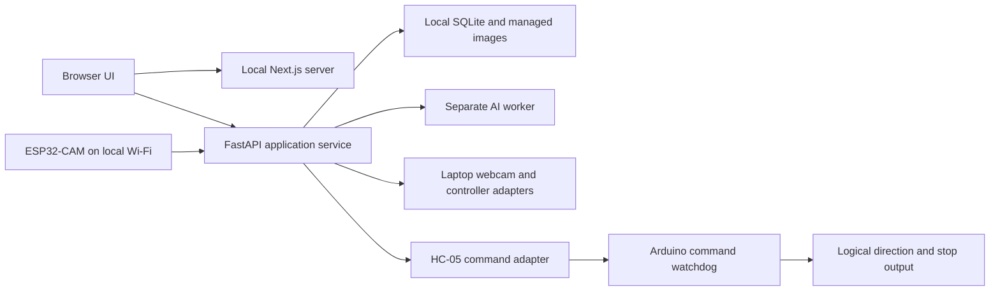

# Lost and Found — Architecture Decision Record

## Authority and design paradigm

This is the canonical technical decision record. Alisa adopted AD-1–AD-14 during the guided architecture session on 2026-11-05 and approved AD-15 on 2026-11-06. Version 1.3 implements the authorized 2026-11-13 scope cleanup, amending AD-3/AD-5/AD-14 and the acceptance evidence boundary under [PRD v1.3](PRD.md), section 9. Earlier adoption dates do not imply prior approval of these amendments. The PRD owns scope and acceptance. This record governs technical invariants; [TRD v1.3](TRD.md) derives the implementation contracts. A conflict requires an explicit upstream revision, never an implicit override. Documentation finalization does not establish device compatibility or measured performance.

Use a **layered modular application with one authoritative local service**. Next.js owns presentation. FastAPI owns application state and coordinates adapters for devices, AI and storage. AI runs in a separate worker process and cannot command motors or mutate records. Arduino owns the final command-expiry stop. Implementation contracts below these boundaries live in the TRD.

Arrows represent permitted request/data dependencies and end at firmware/logical interfaces. Next.js never writes the database or drives a device; only FastAPI accesses those adapters. Device and worker outputs are observations, not authoritative session mutations.

## Invariants and rules

### AD-1 — Local browser application [ADOPTED]

- **Binds:** All application units; NFR-1, NFR-3.
- **Prevents:** A remote backend or a native-only interface replacing the chosen surface.
- **Rule:** Run a browser interface and Python backend on the operator's Windows laptop. Complete searching works without internet after setup.

### AD-2 — Frameworks and responsibility split [ADOPTED]

- **Binds:** Frontend, backend, device and persistence units.
- **Prevents:** Competing owners of safety, session state or records.
- **Rule:** Use Next.js, React and TypeScript for presentation and FastAPI for the Python application service. Backend state and eligibility are authoritative. The browser sends actions and displays backend state; it never establishes Found or motor permission itself.

### AD-3 — Separate wireless command and video paths [ADOPTED; amended 2026-11-13]

- **Binds:** Communication adapters; FR-7, NFR-2.
- **Prevents:** Assuming the camera carries motor commands or Bluetooth carries live video.
- **Rule:** Commands travel through the HC-05 Bluetooth serial adapter to Arduino Uno firmware; ESP32-CAM video reaches the backend over existing local Wi-Fi. Configure selected endpoints and validate protocol compatibility at T2. Keep command and video failure handling independent. Fixed-desk multi-room coverage and timing require real-device integration evidence; a permitted wired connection must still meet that scope.

### AD-4 — Two local release services [ADOPTED]

- **Binds:** Frontend build, launcher and deployment.
- **Prevents:** Shipping a static-only frontend or requiring public hosting.
- **Rule:** Run a local Next.js Node server alongside FastAPI. Ship a production frontend build and locally installed runtime assets. The launcher supervises startup/shutdown; it cannot bypass readiness or automatically resume searching.

### AD-5 — Expiring motion permission [ADOPTED; amended 2026-11-13]

- **Binds:** Input, browser, backend and Arduino; FR-4–FR-8, FR-17, SM-2.
- **Prevents:** Continued or replayed motion after input, video, workspace or process failure.
- **Rule:** Permit movement only with fresh selected-mode input, live video and an operational focused/visible workspace. Browser loss, hidden tab/focus loss or required-path failure stops and pauses. Arduino independently expires commands. Recovery requires acknowledgment, restored readiness, explicit Resume and release/reapply of input. Verify software revocation, firmware expiry and logical stop output with measured timing and failure tests. The full wheel-stop target remains 0.5 seconds including loss detection and requires separate external integration measurement under SM-2; software tests alone cannot establish it or consume the entire allowance as a new software-only limit.

### AD-6 — Capability failure and interrupted evidence [ADOPTED]

- **Binds:** Session coordinator and history; UX G1–G3.
- **Prevents:** Automatic restart, invented confirmation or interpreting Stop as rejection.
- **Rule:** AI failure blocks Start or stops/pauses operation. Restart ends unfinished sessions with an interrupted end reason, preserving committed facts. Stop during review saves the screenshot as Not reviewed and ends Lost. A committed Found result stays Found. Interrupted and Not reviewed do not expand the PRD's object/session state vocabularies.

### AD-7 — Local records and managed media [ADOPTED]

- **Binds:** Persistence, history and cleanup; FR-11–FR-16.
- **Prevents:** Partial saved decisions, orphaned evidence and independent storage writers.
- **Rule:** SQLite holds structured records and media metadata; an application-managed local folder holds reference copies and screenshots. Backend owns all writes, review commit coordination and tracked file cleanup. Retry cannot duplicate a decision. Expiry removes related stored data, including media.

### AD-8 — Local processing adapters [ADOPTED]

- **Binds:** Vision, input and command adapters.
- **Prevents:** Cloud inference or browser-owned device pipelines changing the selected boundary.
- **Rule:** Use OpenCV, MediaPipe, YOLOE visual prompting through Ultralytics/PyTorch, Pygame and pySerial. Backend owns webcam/controller access. NVIDIA inference must be qualified on the selected laptop. Exact compatible versions, model checkpoint and matching settings are selected and recorded by early local benchmarks before functional testing; no cloud fallback.

### AD-9 — Retention and storage failure [ADOPTED]

- **Binds:** Settings, persistence and safety; FR-15, UX G5.
- **Prevents:** Searches extending retention, false deletion claims and operation with broken persistence.
- **Rule:** Retention is 1–30 whole days, default seven, measured from registration. Confirmed changes apply immediately to existing registration times after an impact preview; changes are unavailable during Searching/Paused. Preserve the PRD's active-session grace and startup purge. Cleanup failure hides expired data, reports incomplete deletion and blocks new searches/data-changing tasks pending integrity restoration. Active storage failure stops/pauses.

### AD-10 — Held directional controls [ADOPTED]

- **Binds:** Input adapters, guidance and qualification; UX G4.
- **Prevents:** Reversed gesture directions, mixed modes or undocumented controller indices.
- **Rule:** One extended index finger points up/down/left/right in the mirrored displayed webcam view for forward/backward/left/right. Fist, no hand, multiple hands or ambiguity stops motion. PS4 DualShock 4 uses held D-pad directions; release/conflict stops; Circle is emergency stop. UI emergency stop remains available in both modes. PS5 support is removed under PRD v1.1 with supervisor approval. Qualify recognition thresholds and the actual device mapping before driving.

### AD-11 — Reference image contract [ADOPTED]

- **Binds:** Registration UI, validation, storage and inference; FR-1, UX G4.
- **Prevents:** Incompatible target coordinates and inconsistent image acceptance.
- **Rule:** Accept JPEG/PNG only, at most 10 MiB encoded and 20 megapixels decoded; normalize orientation. Store an application-owned copy and one nonzero in-bounds rectangle. Support drag and keyboard position/size fields; replacing the image clears selection. Backend repeats validation.

### AD-12 — Local access and service protection [ADOPTED]

- **Binds:** Browser/API, launcher, storage and deployment; FR-16.
- **Prevents:** Public exposure, foreign-origin control and accidental introduction of accounts or tenants.
- **Rule:** Bind Node and FastAPI to laptop loopback only. Reject unexpected hosts/origins and automatically protect control/data-changing requests without a login screen. Use a Windows-user data folder and local models/assets; robot Wi-Fi uses an existing protected network. No application accounts, roles, cloud service or public access. People using the same Windows account share application records.

### AD-13 — Single owner and explicit service contracts [ADOPTED]

- **Binds:** Every independently built software unit.
- **Prevents:** Concurrent sessions, blocking inference and incompatible or stale messages.
- **Rule:** One FastAPI service owns session mutation and serialized data writes; a separate AI worker cannot block stopping. Use REST for ordinary actions, WebSocket for state/readiness, and backend-provided live video. Carry session IDs, revisions and freshness; coordinate evidence, terminal actions and cleanup. The TRD derives schema, API and protocol details under Alisa's explicit authorization.

### AD-14 — Independent software development and interface compatibility [ADOPTED; amended 2026-11-13]

- **Binds:** Software, firmware, device integration and acceptance.
- **Prevents:** Blocking independent software on device availability or treating compatible messages as measured product qualification.
- **Rule:** Develop application, AI, firmware and integration software against versioned interfaces, using labeled simulators where devices are unavailable. T2 records selected endpoints/device identities, firmware build targets, protocol versions, message validation and compatibility errors. Missing or incompatible configuration blocks only the dependent software connection. Keep runtime versions, model settings, timing, connected-room coverage and visual decisions at T1/T3–T7. Record simulated, software-on-device and external product measurements separately. Physical wiring and assembly are external to this software scope. SM-2 wheel stopping and SM-3 battery endurance remain external measurements; a compatible connection or a twenty-minute application stability run cannot close them.

### AD-15 — Proximity warning has no motion authority [ADOPTED]

- **Binds:** HC-SR04 telemetry, workspace warning and FR-18.
- **Prevents:** An advisory sensor silently becoming obstacle avoidance, a motion stop, or proof that the route is clear.
- **Rule:** Show a silent on-screen warning at a calibrated threshold and clear it only after the sensor reports the agreed clear condition. The sensor never changes movement, session or readiness state. A missing/invalid reading is not a clear reading; the threshold and clear condition remain T4 configuration items.

## Consistency conventions

| Concern | Binding convention |
| --- | --- |
| State | Objects: Lost/Found. Sessions: Searching/Paused/Ended. Review/recovery, interruption reasons and media lifecycles are separate fields. Only committed human confirmation establishes Found. |
| Identity and concurrency | Backend-issued opaque IDs, one session including Paused, one controlling browser lease, session revision on ordinary mutations and durable action IDs for retries. Emergency stop revokes permission without waiting for a revision conflict or disk write. |
| Time and images | UTC registration/review timestamps for persistence; monotonic local clocks for deadlines. Cross-device timestamps require an age bound. ROI uses normalized-orientation source pixels, independent of display scaling. |
| Workers and frames | AI returns session/generation/frame-tagged observations. Late results cannot mutate another session; bounded latest-frame queues prevent backlog masquerading as live video. |
| Evidence and deletion | Durable image preparation precedes review commit. Tracked staging and purge operations recover after crashes. Expired data are inaccessible pending completed physical file deletion. |
| Changes | Amend stable AD IDs for an explicit changed decision; allocate the next ID for a new invariant. TRD contracts cannot weaken this record or the PRD. |

## Stack

Technology families are adopted, not version pins. **AD-8/AD-14 explicitly defer exact versions to gate T1**, overriding a cold-start version pin at documentation time. No row below asserts an installed or tested combination.

| Name | Version |
| --- | --- |
| Next.js / React / TypeScript / Node.js | Exact compatible lock at T1; supported Node LTS |
| Python / FastAPI / Uvicorn | Exact compatible lock at T1; single backend worker |
| SQLite / Python sqlite3 | Record bundled engine and Python build at T1 |
| OpenCV / MediaPipe / Ultralytics YOLOE / PyTorch | Compatible package, model and GPU-runtime lock at T1/T5 |
| Pygame / SDL / pySerial | Exact versions and controller support at T1/T4 |
| Arduino / ESP32 toolchains and firmware | Lock selected board cores, libraries and firmware at T1/T6; device identity, firmware build target and protocol compatibility recorded at T2 |

Official-source technology checks and detailed references are in TRD section 14. Upstream examples establish available mechanisms, not compliance with this system's acceptance targets.

## Capability map

| Capability | Owner | Governing decisions |
| --- | --- | --- |
| Registration and target selection | UI + backend validation/data service | AD-2, AD-7, AD-11 |
| Movement, live view and recovery | Backend coordinator/adapters + Uno | AD-3, AD-5, AD-10, AD-13 |
| Candidate review and human confirmation | AI observations + backend coordinator | AD-6–AD-8, AD-13 |
| History and retention | Backend data/cleanup service | AD-7, AD-9, AD-12 |
| Offline release and qualification | Launcher + team qualification | AD-1, AD-4, AD-8, AD-12, AD-14 |

## Deferred

TRD section 13 defines T1–T7, owners, evidence and timing. Exact versions/checkpoints, numeric timing configuration, device interface compatibility, runtime/route validation and visual approval remain gated. API/schema seed is specified in the TRD and becomes code-owned only through a compliant, versioned implementation; structural changes cannot bypass these ADs. No architecture or qualification gate is silently resolved by a framework's defaults.
