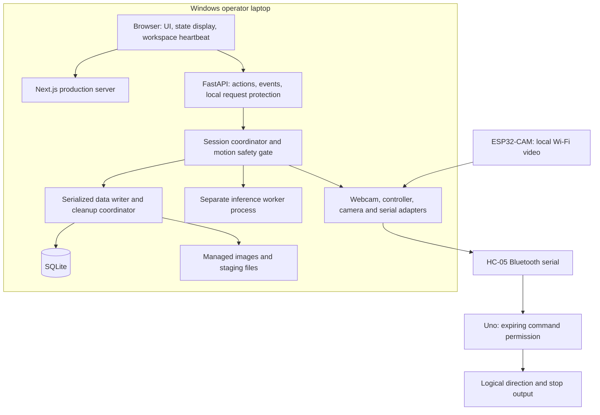
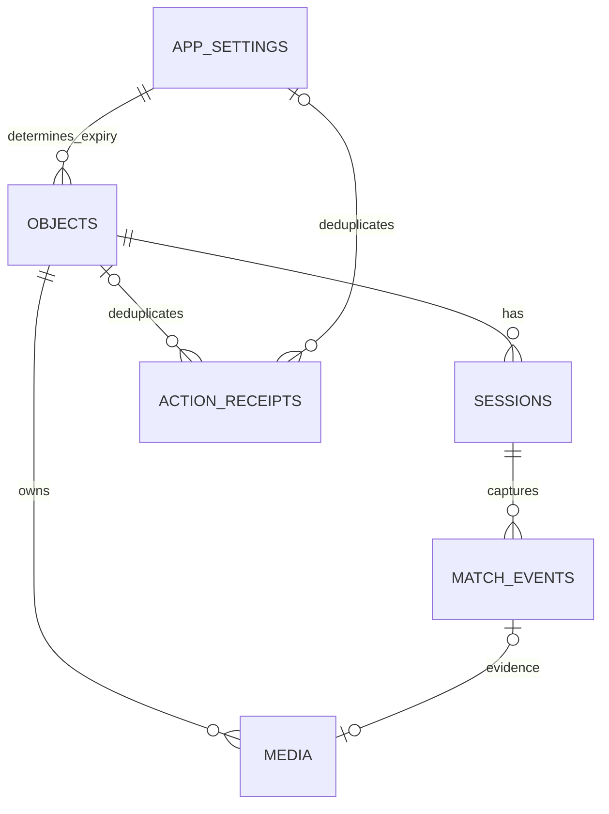

# Lost and Found — Technical Requirements Document

## 1. Purpose, authority and readiness

This TRD defines the software implementation contract for the Windows laptop application, AI, firmware and logical device interfaces of the manually driven camera robot. It covers presentation, backend services, local records, software connections, stopping/recovery, security, deployment and measurable acceptance. It describes required behavior, not an existing implementation or a qualified complete system. Physical wiring and assembly are handled externally by Alisa.

Read sources in this order:

1. [PRD v1.3](PRD.md): scope, FR-1–FR-18, NFR-1–NFR-6 and success metrics, including the authorized 2026-11-13 acceptance wording amendment in section 9.
2. [Architecture v1.3](ARCHITECTURE.md): AD-1–AD-14 adopted by Alisa on 2026-11-05 and AD-15 adopted on 2026-11-06, with dated amendments to AD-3/AD-5/AD-14 on 2026-11-13. This is the technical source of truth.
3. This TRD: detailed contracts derived under Alisa's explicit authorization.
4. Historical UX inputs: `EXPERIENCE.md` and `DESIGN.md` were referenced under `_bmad-output/planning-artifacts/ux-designs/ux-Robotics-2026-11-05/`. They are absent from the tracked baseline. The adopted flow, input and accessibility rules are retained in sections 4–6 and 12; this contract does not depend on retrieving those missing artifacts. Branding is still deferred.

The earlier design session resolved UX G1–G3 through AD-6, input/image rules in G4 through AD-10/AD-11, and G5 through AD-9. PRD v1.1 and AD-15 record the PS4-only and advisory proximity-warning decisions. G4 thresholds/device qualification, G6 branding/accessibility qualification and G7 equipment/performance remain explicit gates. Historical UX proposals apply only where explicitly adopted here; PRD v1.3 and architecture v1.3 govern this software contract. The addendum's former stack proposals are adopted only to the extent explicitly recorded in AD-2/AD-8.

Alisa authorized documentation completion with the section 13 gates open and the 2026-11-13 cleanup plan implemented here. Software and simulator development can proceed independently of device availability. Device-connected software checks T2 interface configuration/compatibility and the applicable runtime, firmware and protocol gates. Assessed acceptance requires the software and real-device evidence specified in PRD section 7; simulator results cannot establish wheel stopping, battery endurance or room-to-room coverage. A failure to meet a target requires evidence and an explicit requirement/architecture revision, not a smaller demonstration presented as a pass.

## 2. Operating scope and technology stack

One operator at a fixed desk uses one Windows laptop, one robot, one selected target and at most one active session, including Paused. The robot searches two adjacent connected rooms on one floor. Gesture and PS4 DualShock 4 control are required; PS5 support was removed with supervisor approval. Internet is unnecessary after setup; protected local Wi-Fi remains available. The laptop camera supplies gesture input and the ESP32-CAM supplies robot video. Navigation is manual, using live video. People remain clear of the route and obstacles are stationary.

No autonomous navigation, obstacle avoidance/steering, servo functionality, mapping/GPS, retrieval, public sharing, cloud accounts, guaranteed unique-object recognition or additional operating systems are introduced. The HC-SR04 is advisory only: it produces the FR-18 silent visual warning and never commands a stop, pause or direction. A visually similar candidate requires human review.

| Layer | Selected technology | Responsibility / version condition |
| --- | --- | --- |
| Browser interface | Next.js, React, TypeScript | Interactive UI; local production Node server. Use the official create-next-app starting point with explicit project settings; do not adopt optional styling defaults as branding decisions. |
| Frontend runtime | Supported Node.js LTS | Required in the release; static export was explicitly not selected. Pin a version compatible with the selected Next.js release at T1. |
| Application backend | Python, FastAPI, Uvicorn | One authoritative service and one Uvicorn worker; no reload in the release. Exact compatible Python/framework versions at T1. |
| Persistence | SQLite through Python sqlite3 | One serialized write owner, explicit transactions, foreign keys enabled on every connection; record actual engine version at T1. |
| Video and images | OpenCV | Webcam capture, image processing and frame decoding. Preserve source freshness metadata outside the decoder. |
| Gestures | MediaPipe hand landmarks | Derive the approved pointing directions from landmarks; do not assume the canned gesture labels implement arbitrary pointing directions. |
| Candidate matching | Ultralytics YOLOE visual prompting, PyTorch | Prompt with the selected reference region; use the laptop's NVIDIA GPU after compatibility and performance checks. Exact checkpoint/settings at T1/T5. |
| Controller | Pygame/SDL | Backend reads the selected PS4 DualShock 4 and handles hotplug/disconnect. Qualify the actual device mapping. |
| Movement connection | pySerial; HC-05 Bluetooth serial | Bounded command/response I/O to Arduino; no browser Bluetooth requirement. |
| Firmware | Arduino Uno firmware; ESP32-CAM firmware | Command-expiry stopping; camera acquisition/freshness metadata and local video. Toolchain/board-core versions at T1/T6; selected identity and firmware build target at T2. |

No exact package/runtime combination has been approved or installed by this document. AD-8 expressly defers that lock until early laptop benchmarking. T1 records exact versions, dependency locks, GPU/runtime compatibility, model files and checksums. All required models, fonts, scripts and frontend assets are installed locally. Neither development nor release may add a mandatory hosted inference service.

## 3. System architecture and responsibilities

Use a layered modular application with one authoritative local service. Node serves the UI; it does not own records, motor permission or session state. Backend adapters isolate device and library details from the session coordinator.

This software/data topology ends at firmware and logical output interfaces. PRD section 6 defines the required software capabilities. Section 6.5 defines device interface configuration and compatibility; no physical-work handoff is an implementation dependency.

| Unit | Owns | Must not do |
| --- | --- | --- |
| Browser | Screens, image/ROI editing, accessibility, display transforms, visible/focused workspace heartbeat and displayed-frame acknowledgment | Open device connections, write records, assert Found, manufacture freshness, or grant motor permission locally |
| Next.js server | Local frontend rendering/assets and automatic launch bootstrap | Write SQLite, run an independent search state machine or expose device controls as a second backend |
| API/session coordinator | Backend-issued IDs, state transitions, readiness, controlling-client lease, latches, validation and ordered actions | Trust a browser's claimed eligibility or a worker's stale result |
| Motion safety gate | Immediate permission revocation, fresh-input arbitration, command renewal and loss deadlines | Wait for AI inference, media encoding, database commit, Next.js rendering or an ordinary action queue to stop |
| Data writer/cleanup coordinator | Serialized transactions, idempotent writes, evidence preparation, retention and recovery | Treat SQLite and filesystem operations as one atomic transaction |
| Inference worker | Reference prompt preparation, candidate boxes and session-level candidate tracking observations | Drive motors or update object/session/review rows directly |
| Device adapters | Device observations, bounded buffers, source timestamps, connection generations and failures | Convert reconnection into Resume or reuse the previous movement command |
| Uno firmware | Default-disabled outputs, bounded parser, command expiry, stop handling and handshake | Continue a last direction indefinitely or accept an obsolete command as fresh |

Use a single backend owner lock for the configured data directory and device connections. A second backend instance refuses ownership. One browser lease can control the active session; another tab may read state but cannot silently take control. Transfer after disconnect requires explicit acquisition, restoration/acknowledgment and Resume; it never auto-rearms motion.

The coordinator serializes logical state changes and submits disk work to the sole write owner. Safety permission can be revoked immediately without waiting on that disk work. If the durable state cannot be updated, the effective operational state is stopped/Paused with a storage failure; the UI must distinguish this from a successfully saved outcome. Restart reconciles durable unfinished sessions under section 5.

AI runs in a separate process. Capture/decode, controller polling, serial I/O and persistence use bounded execution paths outside request handling. Each consumer receives only the latest eligible frame; discard superseded frames rather than letting a queue grow. The AI worker receives session ID, generation, reference revision, frame ID and freshness metadata. The backend rejects candidate/matching results for Paused/Ended sessions, old generations or stale frames. Separately typed continuity-only observations may update an existing suppression context while Paused if session/generation/frame guards pass; they cannot create a candidate, run reference matching, change domain state or authorize motion.

## 4. Frontend contract

| Surface | Frontend responsibility | Backend dependency |
| --- | --- | --- |
| History | Local name search, Lost/Found filtering and distinct empty/error states | Retention-filtered objects and search results |
| Registration | Required name, JPEG/PNG validation, reference preview and rectangular target selector | Repeat validation; commit only a complete record |
| Object/session detail | Reference, status, registration/expiry, every session and review evidence | Durable facts; expired/missing media must not be replaced with unrelated images |
| Search setup | Target summary, exclusive mode selection, readiness and mapping instructions | Atomic Start guard; no session until accepted |
| Workspace | Required left laptop-webcam/gesture panel and right robot-video/AI panel; target/mode/state; stable controls; silent HC-SR04 warning | Authoritative session, latest eligible frames, proximity-warning state and readiness |
| Match review | Captured evidence/box, reference comparison, Confirm/Reject/Stop | Candidate paused before review; consistent persisted decision |
| Recovery | Every unresolved cause, acknowledgment/readiness and Resume eligibility | Latched failures and fresh-input rearm |
| Retention settings | Integer 1–30 days, impact preview, explicit confirmation, save/error feedback | Reject change during active/Paused session; preserve prior value on failed save |

Use backend snapshots on load/reconnect; browser memory is not a durable store. Show pending actions and disable duplicate submission. Do not announce Found, Ended, saved evidence or completed deletion until the corresponding backend commit/cleanup result establishes it. Motion permission is revoked immediately even when persistence remains pending.

In controller mode, gesture control is inactive; denied/unavailable webcam does not block controller operation. Preserve the left panel's inactive label and show webcam imagery only where available. In gesture mode the selected webcam/input is required. The inactive controller or webcam is not an unrelated readiness blocker.

Use modeless review/recovery/help while a session is active; emergency stop stays visible and keyboard-operable, including during saving or failure. Navigation away revokes motion and pauses first; leave confirmations must distinguish staying from explicitly stopping the session. Keep the active session discoverable and prevent another session, mode/target changes or implicit Resume. The UX's IA2 navigation grouping remains guidance, not an additional backend ban on registering an independent record. Window close, tab hidden/focus loss or an unusable operational layout revokes motion and pauses; returning alone never resumes. Layout-specific thresholds are measured at T7 rather than invented here.

Retain the UX accessibility goals: labeled controls/errors, keyboard navigation and ROI fields, visible focus, status beyond color, meaningful change announcements, 200% text enlargement and the documented contrast/reflow targets. Keyboard ROI selection is adopted in AD-11; the remaining proposed UX accessibility criteria require T7 approval and verification rather than becoming new approved PRD NFRs here. Branding/tokens remain provisional; no UI kit, palette or icon library is silently adopted. Qualify the operational layout at T7.

## 5. Domain states, transitions and failure outcomes

Object state is exactly **Lost** or **Found**. Session state is exactly **Searching**, **Paused** or **Ended**. A Paused session remains active and locks target/mode. End reasons, pause causes and evidence dispositions are separate fields.

| Trigger | Operational result | Durable result / eligibility |
| --- | --- | --- |
| Register complete usable image/name/ROI | No movement | New independent Lost object with immutable registration time |
| Start | Searching, initially disarmed until neutral then fresh input | Require Lost/unexpired target, no active session, healthy storage/AI, selected input, command path, live/displayed video and controlling workspace |
| Release/unrecognized gesture/conflicting input | Stop movement | May remain Searching while required capabilities are healthy |
| HC-SR04 reading crosses calibrated warning threshold | No change to movement or session state | Show silent advisory warning; clear after calibrated clear condition; never infer safety from a missing/invalid reading |
| Pause | Stop movement and matching; Paused | Same session, target and locked mode |
| Potential match | Revoke movement and matching before review | Paused; retain exact candidate frame/box; prepare durable evidence |
| Confirm | Remain stopped | Atomically set candidate Confirmed/review time, object Found/confirmation time and session Ended; evidence must be durable |
| Reject | Remain stopped/Paused | Save Rejected/review time; object stays Lost; explicit Resume required |
| Stop | Stop movement/matching immediately | End unsuccessful session, object stays Lost; pending evidence becomes Not reviewed and is saved |
| Emergency stop/path failure/browser loss | Stop and latch Paused | Store known causes when storage permits; all required restoration and acknowledgment needed before Resume |
| AI failure | Block Start or stop/pause | Restoration does not Resume; use the same deliberate recovery sequence |
| Storage/read/write/cleanup integrity failure | Block Start or stop/pause | Never claim unsaved success; repair/retry while stopped; no new data-changing task except required recovery/cleanup |
| Backend restart | Begin disarmed; reconcile before data access | End every durable unfinished session with end reason Interrupted. Preserve committed reviews/Found results; no automatic session continuation |

On restart, a pending candidate with durably prepared evidence becomes Not reviewed within the interrupted session. If capture/decision was never durably recorded, do not reconstruct a screenshot or review from guesses. Staged files are either reconciled by their durable operation record or removed as uncommitted orphans. A committed confirmation remains Found even if its response was lost. Expired records are purged before restart outcomes become visible, subject only to a still-running session's grace; a restarted interrupted session is now Ended and has no grace.

Serialize candidate/terminal actions with session revisions and action IDs. Only the first valid terminal commit wins; a later conflicting Confirm/Stop is rejected, not applied a second time. Emergency stop always revokes permission even if its accompanying state update is racing with a terminal action. A completed Found transaction is not reversed by that stop or a later connection fault.

Rejected candidate suppression belongs to the session, not permanent identity recognition. Continue only the minimal live tracking needed to determine continuity while matching/alerts are paused; do not run candidate matching in Paused. Preserve suppression context across rejection, pause and recovery. Uncertain continuity after tracking/video failure is not proof of exit: retain suppression while the approved recovery/Resume sequence allows searching and movement to continue. Do not add an absent-view prerequisite to Resume. Tracking association/exit thresholds are frozen and tested at T5. The rejected candidate becomes eligible after observed exit/re-entry; another similar object is not automatically a permanently rejected identity.

## 6. Inputs, video freshness and motion safety

### 6.1 Input mappings

| Mode/input | Action |
| --- | --- |
| One index finger pointing up/down/left/right in mirrored displayed webcam coordinates | Forward/backward/left/right while held |
| Closed fist, no hand, multiple hands, ambiguous/invalid pointing | Ordinary motion stop; no stale direction substitution |
| PS4 DualShock 4 held D-pad up/down/left/right | Forward/backward/left/right |
| D-pad release or conflicting directions | Ordinary motion stop |
| PS4 DualShock 4 Circle; UI Emergency stop in either mode | Emergency stop and recovery latch |

The backend reads the laptop webcam/controller directly. It reports input samples with connection generation and monotonic age. No webcam image needs to be uploaded from the browser. Inactive-mode input never commands motion. Poll/pump controller events independently of browser focus, then apply the focused-workspace gate; do not rely on default SDL foreground behavior to provide safe samples. Verify the PS4 DualShock 4 profile rather than hardcoding a guessed joystick index. Thresholds, ambiguity boundaries and firmware speed/PWM choices remain T4/T6 configuration gates.

### 6.2 Live video

The backend ingests ESP32-CAM JPEG frames over local Wi-Fi and supplies a bounded JPEG frame channel to the browser through a dedicated WebSocket. Send metadata and binary payload together as one identified frame; the client decodes/draws it and acknowledges the displayed frame ID on the control/event channel. This derived transport preserves metadata that a plain image element would hide. Webcam preview can use the same frame envelope on a distinct channel.

Each robot frame carries camera boot/stream epoch, increasing acquisition sequence, acquisition timestamp, backend receive time and backend frame ID. Preserve capture metadata through decoding, matching and evidence. Espressif's example exposes an acquisition timestamp mechanism, but is only a starting point; a custom firmware envelope/sequence and clock-age verification are required. [Espressif camera source](https://raw.githubusercontent.com/espressif/arduino-esp32/master/libraries/ESP32/examples/Camera/CameraWebServer/app_httpd.cpp)

Repeated receipt, re-encoding or heartbeat messages do not make an old frame live. Establish a conservative capture-age bound using a bounded round-trip clock-offset exchange with the camera; include uncertainty, transport, queueing and decoding. Never subtract unrelated device clocks directly. Unbounded uncertainty, repeated/stalled capture metadata or missing displayed-frame acknowledgment makes required video unavailable. A new camera epoch invalidates the prior timing estimate and requires readiness recovery. A static scene with genuinely fresh captures is valid; pixel similarity alone is not a freeze detector.

While Searching, permit movement only when both backend acquisition freshness and browser displayed-frame freshness are within the qualified budget. Display a persistent Not live label on stale/frozen video, including when the last image remains visible. AI analysis may use a different eligible frame from the newest displayed one; boxes are tagged to their own frame and never drawn over an unrelated frame. Review uses the immutable detection frame, labeled Captured evidence. No full-video recording is required.

### 6.3 Command permission and stopping

Use three independent revocation points: browser workspace lease, backend safety gate and Uno command-expiry watchdog. An ordinary REST request cannot authorize indefinite movement. Every movement renewal requires currently healthy gates, fresh selected-mode held input and a valid session/control generation. STOP has priority and bypasses ordinary revision-conflict handling.

The serial protocol is versioned and bounded. Commands include boot/control generation, strictly increasing sequence, direction and a device-issued expiring challenge. Uno accepts a challenge only before its own monotonic deadline and never extends that deadline because an old packet arrived. Stop/expiry invalidates the armed generation; stale/queued/replayed movement frames cannot rearm it. Initial Start and fault recovery require their approved user gates, then neutral input and a fresh hold. An ordinary release/recognition stop while otherwise healthy Searching does not latch a fault: the backend may perform a new generation/ARM handshake for the next neutral-then-fresh hold without Pause/Resume. An emergency, expired command or required-path failure never uses that ordinary rearm path. Check framing/integrity and ranges before updating permission; invalid/oversized/partial packets do not refresh the watchdog. Stop outputs on boot/reset, loss of valid renewal or parser failure. Protocol encoding, maximum packet length, serial rate, timers and logical direction/stop output behavior are frozen at T6 for the selected firmware build target. Board-specific code settings, including speed/PWM configuration, remain versioned build configuration.

The Uno response identifies firmware/protocol version, boot generation, challenge, accepted sequence and logical output/armed state. This reports commanded output, not sensed wheel movement; no encoder/stop telemetry is assumed. A missing/invalid command acknowledgment causes backend failure handling. The firmware loop must remain nonblocking so command expiry is checked even if a message never completes.

For every SM-2 path, software verification measures loss/input detection, permission revocation, transport or last-valid-device-lease expiry, and logical output change. Exercise backend termination, queued/replayed packets and missing acknowledgments independently; a fast explicit STOP is insufficient. Record whether timing comes from simulation or the selected firmware/device. No software-only 0.5-second limit replaces the wheel-stop requirement.

External product integration must measure the full SM-2 budget from the actual release/loss event to wheels stopped:

`loss/input detection + permission revocation/transport or last-valid-device-lease expiry + output change + measured mechanical stopping <= 0.5 seconds`.

Conservatively include outstanding valid challenges/commands, scheduling delay and clock-age uncertainty. Timers cannot each consume the full 0.5-second allowance, and the software allocation must leave margin for mechanical stopping. T6 records measured component timings and their allocation; the full target remains unverified until external event-to-wheel measurements establish positive remaining margin. Logical output reports do not prove wheel stopping. No numeric watchdog value or stopping capability is asserted here.

### 6.4 Advisory proximity warning

The HC-SR04 telemetry supplies proximity observations for FR-18. T2 identifies the configured observation endpoint and compatible message version; T6 defines bounded distance units, validity, sample identity and freshness handling. T4 calibrates separate warning and clearing distances and a consistent-clear condition through controlled integration tests to prevent flicker. Synthetic readings verify threshold/clearing logic, not real distance accuracy. The workspace displays a silent warning and clears it only after fresh valid readings meet the tested clear condition. Missing, stale or invalid readings are unknown, never clear. This advisory path has no authority over movement, session state or motion readiness.

### 6.5 Device interface configuration and compatibility (T2)

Configure and validate each software connection independently. T2 defines compatibility inputs for adapters and firmware; it does not certify physical performance.

| Configuration | Required software information and checks |
| --- | --- |
| Selected endpoints and identities | Windows serial identity/settings for the selected HC-05/Uno path, ESP32-CAM stream endpoint, selected webcam/controller profile and proximity observation endpoint. Keep credentials in protected local configuration outside Git. |
| Firmware build compatibility | Selected Uno/ESP32 build targets, board-core/library versions, firmware hashes and versioned code configuration. Cross-check T1/T6; logical direction/disabled/reset behavior must match the adapter contract. |
| Protocol compatibility | Command/response and telemetry versions, frame envelope/clock-age mechanism, units and negotiated bounds. Reject unsupported required-path versions before arming motion. Reject incompatible proximity messages as unknown observations without changing motion readiness. |
| Validation and errors | Check identity/generation, framing, payload lengths, field types/ranges, sequence/challenge expiry, timestamps and acknowledgment semantics. Required-path incompatibility leaves the path unavailable and motion disarmed; malformed proximity data remains unknown under section 6.4. Report actionable compatibility errors without secrets. |
| Changes and evidence | Record configuration revision, observed versions, affected adapter and test result. Changed endpoints/builds/protocols invalidate affected compatibility evidence until rechecked. Connection success alone is not functional or performance qualification. |

Missing or incompatible configuration blocks only the software connection that consumes it. Application, AI, parser/protocol tests, synthetic telemetry and frame fixtures can proceed without devices. Label simulator results explicitly; simulated output is not device feedback. A successful firmware build, a compatible connection, software behavior checks and complete product measurements are distinct results. Keep all runtime arming, expiry and recovery rules in sections 5–6 regardless of connection source.

## 7. Database schema and relationships

The following is the initial logical schema, derived from the approved state and persistence rules. Use backend-generated opaque TEXT IDs, UTC integer milliseconds for durable times, INTEGER dimensions/revisions, and constrained TEXT enumerations. Monotonic deadlines are runtime-only; store restart/end facts rather than reusing a previous process's monotonic clock.

The settings relationship is logical, not a per-object settings FK. Every object has exactly one committed reference media row. Every committed candidate requires one evidence media row; preparation may temporarily precede commitment. Cleanup jobs intentionally survive until files are removed, so they do not disappear through a cascading parent deletion.

| Table | Required columns / meaning | Relationships and constraints |
| --- | --- | --- |
| `objects` | `id`, `name`, `status`, `registered_at_ms`, `found_at_ms` nullable, `roi_x`, `roi_y`, `roi_width`, `roi_height`, `revision`, `deletion_pending` | Lost/Found CHECK; nonblank name; positive in-bounds ROI against normalized reference dimensions; Found iff confirmation time present. Registration time immutable. Duplicate names allowed. Deletion flag is internal lifecycle, not an object status. |
| `sessions` | `id`, `object_id`, `control_mode`, `state`, `started_at_ms`, `ended_at_ms` nullable, `end_reason` nullable, `pause_causes`, `revision` | FK object CASCADE; mode Gestures/Controller; state Searching/Paused/Ended; consistent end time/reason. Partial unique index on a constant for state Searching/Paused enforces one active session globally. UNIQUE `(id, object_id)` supports ownership checks. |
| `match_events` | `id`, `session_id`, `object_id`, `captured_at_ms`, `frame_id`, `stream_epoch`, `box_x/y/width/height`, `disposition`, `reviewed_at_ms` nullable | Composite FK `(session_id, object_id)` to sessions CASCADE. Disposition Pending/Confirmed/Rejected/NotReviewed is evidence lifecycle only; reviewed time required for Confirmed/Rejected. At most one pending candidate per session; UNIQUE `(id, object_id)`. Bounds refer to saved evidence pixels. |
| `media` | `id`, `object_id`, `match_event_id` nullable, `role`, `relative_path`, `format`, `width`, `height`, `byte_length`, `checksum`, `created_at_ms`, `lifecycle` | Object FK CASCADE; composite candidate/object FK CASCADE when present. Unique generated relative path. Partial unique reference per object and evidence per candidate. Role Reference requires null candidate; Evidence requires matching candidate. Staging/Ready lifecycle is internal. |
| `action_receipts` | `action_id`, `scope`, `object_id` nullable, `settings_id` nullable, `session_id` nullable, `action_type`, `request_fingerprint`, `result_revision`, `committed_at_ms` | Unique action ID; scope Object/Settings with exactly one matching owner FK. Object FK CASCADE; settings FK references singleton; composite session/object FK when session is present. Settings receipts require null session. Persist with the action; changed scope/type/payload under the same ID conflicts. Object expiry cascades object-owned receipts; settings receipts contain no object data. |
| `app_settings` | singleton `id`, `retention_days`, `revision`, `updated_at_ms` | Exactly one row; integer retention 1–30, initial seven. Settings persist independently of object expiry. |
| `storage_operations` | `id`, `kind`, `owner_object_id` nullable, `generated_paths`, `phase`, `created_at_ms`, `last_error_code` nullable | Durable staging/purge journal. Opaque IDs/paths only, no duplicate image/name payload. Intentional non-cascading cleanup record; remove on completed reconciliation/purge. |
| `schema_migrations` | `version`, `applied_at_ms`, `checksum` | Monotonic migration versions; refuse incompatible schema rather than silently recreating history. |

Enable SQLite foreign keys on every connection. Apply CHECK/UNIQUE/FK enforcement plus transactional application guards where image bounds and cross-table state cannot be expressed directly. New sessions require a Lost object; an Ended session cannot Resume; historical Found cannot reopen. Index sessions by object/start, matches by session/capture, and objects by registration/status; name lookup is parameterized local substring matching. UI ordering uses registration time then ID; session/review histories use event time then ID. Do not use an SQL wildcard supplied by the user as executable query syntax. [SQLite constraints](https://www.sqlite.org/foreignkeys.html), [Python sqlite3](https://docs.python.org/3/library/sqlite3.html)

The data writer owns the connection used for mutations and explicitly commits/rolls back. Read paths must apply expiry/lifecycle filters too. Use durable SQLite settings appropriate to committed-history survival; performance tuning cannot weaken durability. Record transaction/journal configuration at T1. No ORM or external database service is selected or required.

## 8. Evidence consistency and retention

### 8.1 Consistent saves

Registration and candidate capture use generated paths under the managed root. Write and flush staging files, validate/checksum them, and prepare a durable storage operation before promoting a complete image to its final path. Only then commit the linked Ready metadata and domain transaction. Reconcile interrupted operations before history/search becomes available. Never expose a committed screenshot path whose preparation failed; orphan staging files are not user evidence.

Confirmation commits candidate disposition/time, object Found/time, session Ended/time and action receipt in one SQLite transaction. It references already prepared evidence. Rejection/Stop similarly commit the review/end facts and receipt together. Keep the robot stopped during failures and retries. A lost HTTP response is recovered by action ID/snapshot, not by inventing a second action. If the record expired after its session ended, a retry returns expired/missing rather than recreating it.

SQLite cannot atomically rename/delete filesystem images. The storage journal, generated paths, idempotent recovery and ordering above provide the required cross-store consistency. Missing/corrupt evidence is reported as unavailable; do not silently mark a failed confirmation saved. Previously committed facts remain distinguishable from a later media-integrity error.

### 8.2 Retention algorithm

`expiry = registered_at_ms + retention_days × 86,400,000`.

An active session, including Paused, grants grace only until that session ends. A search does not move registration time. Changing settings recalculates expiry from each original registration; preview and confirm affected records, and commit against the settings revision used for that preview. Retention settings changes are blocked during an active session. Registering another independent record does not change the active target or permit another active session. Never reset registration time to make settings changes appear harmless.

On startup, acquire ownership, recover storage/schema state, end interrupted sessions, then purge expired records before any history, evidence or search access is enabled. While open, schedule cleanup at the next expiry and re-evaluate on settings changes, session end and system time changes. On wake from sleep, disarm/pause operation and re-evaluate freshness/expiry before resuming. Crossed-expiry data without a Searching/Paused session's grace are denied on every read/action even if a cleanup task is delayed. Grace permits that existing session's review, history and control actions through its end; it never permits another session or extends registration time.

To purge: mark the object deletion-pending and record all owned reference/evidence/staging paths in a durable purge operation; deny access; delete managed files idempotently; then delete the object with cascading sessions/matches/media/receipts and remove the completed operation. Recover/retry after crashes. Treat an already absent owned file as successfully removed; path-validation failure is an integrity error. Do not report deletion complete while images or owner rows remain.

Cleanup failure keeps the object inaccessible, reports incomplete deletion and blocks new searches/data-changing tasks until repaired. Safety Stop/Pause and necessary repair/cleanup remain permitted. Notify connected browsers to clear thumbnails/evidence when expiry is effective; the browser clears on an idle record's expiry deadline or on session-end grace removal, preserving the active/Paused session's evidence until then. Do not cache evidence in browser persistence, Node's public directory, Next.js image-optimization/data caches, logs or an independent backup feature. Fetch protected media directly in the browser with no-store handling, and revoke temporary object URLs when the view clears. Deletion covers application-managed copies; it does not delete the user's original selected source file or promise forensic erasure of the storage device.

## 9. API, event and integration contracts

### 9.1 HTTP actions and shared payloads

Version the API under `/api/v1`. These endpoint names define an initial contract, not implemented routes. Mutations carry `action_id`, applicable `session_id`, `expected_revision` and a typed payload. Registration/Start/settings have their own atomic guards. Use structured error codes and a safe explanatory message; include current revision/snapshot where useful, never a traceback or filesystem path.

Domain IDs are backend-issued opaque strings. The frontend generates unique action IDs for retry; they are not object IDs or credentials. Domain enum values use the exact casing in section 7. Action names on the wire are `pause`, `resume`, `stop`, `acknowledge`, `confirm`, `reject`; an unknown action is rejected. An `expected_revision` is an integer scoped to the resource being changed: object for Start, session for session/review actions, settings for retention. Registration has no prior resource revision. Check an existing action receipt and fingerprint before checking a now-stale revision so a committed retry returns the original result. Session actions never interpret an object/settings revision as their own.

| Shared payload | Required fields and interpretation |
| --- | --- |
| Registration | `action_id`, `name`, reference image bytes, and `roi` with integer `x`, `y`, `width`, `height` in orientation-normalized source pixels. Payload values must not use scaled display coordinates. |
| Start | `action_id`, `object_id`, `expected_revision`, `control_mode` (Gestures/Controller). Atomically assert no active session. |
| Session action | `action_id`, `session_id`, `expected_revision`, `action`; `candidate_id` for confirm/reject; `failure_ids` string array for acknowledgment. Reject unrelated candidate/failure ownership. |
| Retention change | `action_id`, settings `expected_revision`, `retention_days`, `preview_id`, `confirmed=true`. Backend validates the preview against current eligible records before committing. |
| Error | `code`, safe `message`, `retryable`; optional current `revision` and authoritative snapshot. No stack trace, secret or absolute media path. |

FastAPI owns the versioned REST/OpenAPI definitions; frontend types are generated from that contract. The backend also owns versioned event/frame JSON schemas and their generated TypeScript types. Freeze these shared definitions before splitting frontend/backend work; neither unit independently renames fields, enums, revision scopes or message types. Schema generation is implementation work, not an artifact already produced here.

### 9.2 Endpoints

| Endpoint group | Contract |
| --- | --- |
| `GET /bootstrap`; `POST /websocket-tickets` | Origin/Host-checked, no-store automatic bootstrap returns backend-issued `client_id` and per-run capability. Protected ticket request names the event/robot-video/webcam-video channel and client; returns a short-lived single-use ticket for that scope. Neither endpoint grants a motion lease or starts searching. |
| `POST /control-lease`; `POST /control-lease/release` | Protected runtime requests use `request_id` and `client_id`. Acquire also names nullable active `session_id` and explicit `takeover` after prior ownership expired/released. Return `client_lease_id`, `control_generation` and lease state. Reject takeover of a healthy owner; release revokes permission and pauses an active session. Runtime request IDs deduplicate only within the backend boot; they are not durable domain action receipts. |
| `GET /health`, `GET /snapshot` | Distinguish process health, initialization, storage integrity, readiness and operational state. Health is not permission to move. |
| `GET/POST /objects`; `GET /objects/{id}` | Local name/status lookup; multipart reference upload/name/ROI registration; retention-filtered detail. No arbitrary filesystem path input. |
| `POST /sessions`; `GET /sessions/{id}` | Atomically Start one eligible session; retrieve durable facts and current revision. Mode/target fixed at creation. |
| `POST /sessions/{id}/actions` | Pause, Resume, Stop, acknowledge failure, Confirm, Reject. Include candidate ID for review and named failure IDs for acknowledgment. Validate every transition server-side. |
| `POST /emergency-stop` | Revoke motion immediately regardless of stale ordinary revision or absent/expired control lease; idempotently publish/persist cause afterward. Valid local capability/origin protection still applies; accepting a stop grants no movement rights. |
| `GET /settings`; `POST /settings/retention-preview`; `PUT /settings/retention` | Preview against current settings revision; require explicit confirmation and no active session; reject changed/stale previews. |
| `GET /media/{id}` | Ready, unexpired/grace-eligible media only; generated ID lookup, safe content type and no-store response. Never expose the media root as static files. |
| `WS /events` | Initial snapshot then ordered state/readiness/candidate/recovery/expiry events. Accept protected workspace heartbeats and displayed-frame acknowledgments under a controlling-client lease. |
| `WS /video/robot`; `WS /video/webcam` | Metadata + bounded JPEG frames; backend provided, no control commands accepted here. Independent bounded delivery prevents a slow video consumer blocking stop/state messages. |

Use success responses only for established outcomes; a pending save is explicitly pending. Use 400/422 for invalid input, 403 for local request/lease rejection, 409 for revision/state/action-ID conflict, 404/410 for absent/expired data, and 503 for required service/storage unavailability. Generic error responses must not hide a still-latched stop cause.

### 9.3 Events, frames and control leases

Each JSON state event uses `protocol_version=1`, `backend_boot_id`, increasing integer `event_seq`, nullable `session_id`/`session_revision`, `type`, `occurred_at_ms` and typed `payload`. Types are `snapshot`, `session_changed`, `readiness_changed`, `candidate_pending`, `recovery_changed`, `retention_changed`, `object_removed`, `storage_fault` and `proximity_warning_changed`. A sequence gap/reconnect requires a full snapshot before control eligibility. Snapshots include active session/object facts, resource revisions, required-path readiness, unresolved failure IDs, pending candidate, lease owner/eligibility, proximity-warning state and effective retention deadline/grace. Event order does not substitute for resource revisions.

Video protocol v1 uses one binary WebSocket message per frame: an unsigned 32-bit big-endian metadata-byte length, UTF-8 JSON metadata, then JPEG bytes. Metadata fields are `protocol_version`, `source` (robot/webcam), `stream_epoch`, integer `capture_seq`, `frame_id`, integer `width`/`height`, `received_at_ms` and `capture_age_bound_ms`; robot metadata also carries its source capture timestamp/clock epoch. Encode source monotonic timestamps as integer microseconds and persistent/UTC times as integer milliseconds. Negotiate and enforce frame/header byte limits at T6 before allocation/decode. Display acknowledgment carries the backend-issued `frame_id` and epoch; the backend validates them and includes elapsed time through acknowledgment receipt in its conservative age bound, without trusting the browser's clock.

Workspace heartbeats carry `client_lease_id`, current `session_id`, `control_generation`, increasing `heartbeat_seq`, `workspace_visible`, `workspace_focused` and last displayed robot frame ID/epoch. Control-changing HTTP calls identify their `client_id`/`client_lease_id` as well as the resource/action payload; the backend verifies the live lease, except that protected emergency stop always permits revocation without a lease. Backend-issued runtime control generations change on rearm/revocation; they are distinct from durable session revisions. Heartbeats cannot carry a motor direction or replace backend device samples. Channel closure/heartbeat loss revokes the workspace lease, stops and pauses. Reacquisition/transfer returns a new generation and a snapshot; it does not clear recovery or satisfy Resume. Old browser heartbeats, old frame acknowledgments or an event sequence alone cannot renew readiness. Per-process boot, lease and stream epochs distinguish reconnects from message replay.

Every recovery occurrence has a unique backend-issued `failure_id`, owning nullable session ID, typed `cause`, `observed_at_ms`, `restored` and `acknowledged` flags. Repeated samples of the same outstanding occurrence keep its ID; a new failure after restoration gets a new ID. Acknowledging an old occurrence never acknowledges the new one. Session acknowledgment uses the explicit `failure_ids` in the action payload, and Resume checks all current occurrences plus pending review and fresh-input gates. Emergency stop with no active session remains a disarmed no-op for domain state; it never creates a session just to record a stop.

### 9.4 External integration boundaries

| Integration | Input/output contract | Failure rule |
| --- | --- | --- |
| Laptop webcam | Selected device, timestamped fresh frames; mirrored display coordinates map consistently to direction classifier | In gesture mode: stale/lost input stops and required-device loss pauses; controller mode does not require webcam |
| PS4 DualShock 4 | Selected device identity/profile, D-pad/Circle state, connection generation and sample age | Disconnect pauses; unknown mapping blocks readiness; another controller does not silently replace it |
| HC-05/Uno | Paired Windows serial port; versioned expiring protocol in section 6 | Missing/invalid responses or new Uno boot invalidate readiness and latch recovery |
| ESP32-CAM | Existing protected Wi-Fi, bounded frame envelope and clock-age exchange | Capture/display staleness or uncertain timing stops/pauses; reconnect alone does not Resume |
| HC-SR04 | Configured T2 observation endpoint/version; bounded T6 observations with distance units, validity and freshness; calibrated T4 warning/clear criteria | Missing/stale/invalid data is unknown, never clear. Advisory feedback cannot change motion, session or readiness state |
| YOLOE/MediaPipe assets | Locally installed approved files/checksums and reproducible configuration | Missing/corrupt/incompatible assets block Start; runtime AI failure stops/pauses; no online fallback |

No runtime SaaS integration, cloud database, email, public API or telemetry upload is required. Logs support local troubleshooting and acceptance evidence; they do not publish video or reference images.

## 10. Authentication, authorization, isolation and security

### 10.1 User access and authorization

**Authentication:** No application account or login gate. Access is inherited from use of the Windows laptop/account. Local data access is available to anyone using the application in that Windows account, as FR-16 requires. A launcher-issued request token is an automatic service-protection mechanism, not a user identity or password prompt.

**Authorization:** FastAPI enforces session state, active control mode, one controlling-client lease, action/candidate ownership, revision, readiness, recovery acknowledgment and expiry. Never rely on disabled buttons alone. Allow Stop/Pause even when a competing action is pending. Found cannot be reopened by an API call. Worker/firmware messages cannot perform human confirmation.

### 10.2 Multi-tenant isolation

Multi-tenant isolation is not applicable to the approved single-operator installation. There are no tenant IDs, organizations, accounts or per-user application roles. Object/session/media ownership constraints prevent cross-record associations; these are integrity boundaries, not tenant security. Windows accounts and directory permissions provide the platform boundary; people sharing an account share its records.

### 10.3 Local service protection

Bind Next.js and FastAPI explicitly to `127.0.0.1`; choose and record nonconflicting fixed ports at deployment. Use one exact frontend origin in backend HTTP/WebSocket allowlists and explicit Host validation; no wildcard CORS. Reject foreign/null origins on browser control/bootstrap connections. The frontend may call the loopback API directly; the Python backend remains the only application authority. Use a per-launch unguessable request capability shared securely by the launcher and the two services. Issue it automatically to the allowed local frontend through a no-store, origin/Host-checked bootstrap. Protected HTTP calls use `X-App-Capability`; authorized HTTP obtains a short-lived one-use WebSocket ticket, offered through `Sec-WebSocket-Protocol` with the application's `laf.v1` protocol. Validate/consume the ticket before upgrade and negotiate only `laf.v1`, never echo the secret as the selected protocol. Do not assume the browser WebSocket API can set arbitrary authorization headers. Require protection on control and media channels. Keep capabilities/tickets out of URLs, logs, persistent browser storage and public frontend build assets; rotate on service restart and invalidate old leases. A new token never auto-resumes motion.

CORS alone is not request authorization. Reject unauthorized simple-form mutations and foreign-origin WebSocket upgrades, validate content types and payload lengths, and check capability/lease on every control action. This boundary protects against unrelated web pages; it does not claim isolation from malicious software running as the same Windows user.

### 10.4 Data and input protection

Use parameterized queries, escaped object names, allowlisted formats, content/signature/decode validation and encoded/decoded size bounds. Normalize orientation before selecting/validating ROI, and remove unneeded metadata from application image copies. Store only generated relative media paths, resolve them beneath the managed root, reject traversal and untrusted links/reparse targets, and never accept a client-provided delete path. Do not serve uploaded bytes as executable HTML/SVG. Capture metadata and filenames must not leak outside local logs/data boundaries.

### 10.5 Devices and network

Use the selected paired HC-05 and configured camera endpoint on the protected local network. Store Wi-Fi/device secrets outside source control and ordinary logs. Pairing and Wi-Fi protection do not by themselves prove authenticated or encrypted application video/serial traffic; validate selected identities, endpoint access and protocol compatibility at T2/T3 and restrict local access. No public port forwarding is authorized. Untrusted or incompatible required-path messages fail closed; invalid proximity observations remain unknown without motion authority under section 6.4.

### 10.6 Assets and maintenance

Pin dependencies/model hashes and retain applicable license notices, including the selected Ultralytics/model distribution terms, in the release inventory. Do not fetch replacement weights, fonts or JavaScript at runtime. Application logs exclude screenshots, raw reference images, secrets and object-name dumps. Retention applies to all application-owned evidence copies and staging files. Review exact package advisories and compatibility at T1, then rerun affected checks after changes.

## 11. Infrastructure, deployment and operations

| Concern | Required approach |
| --- | --- |
| Infrastructure | Local Windows services, existing Wi-Fi/Bluetooth endpoints, firmware connections and local model/assets. No cloud infrastructure or container platform is required. |
| Development | Separate frontend/backend dependency environments and labeled fixtures/simulators; development reload requires motion permission revoked and firmware outputs logically disabled. Never start multiple device-owning workers. |
| Release | Production Next.js build plus supported Node runtime, Python environment, local AI assets, schema migrations and versioned firmware. A documented Windows launcher starts both services and opens the local UI. |
| Data layout | Under the Windows user's local application-data root, e.g. `%LOCALAPPDATA%/LostAndFound/`: SQLite, managed media/staging and minimal diagnostics. Keep live data outside source/build directories and cloud-synced project folders. Exact root is recorded in release configuration. |
| Configuration | Nonsecret settings identify local ports, data root and device endpoints. Protected local configuration holds secrets. Qualified input/timing/model configuration is versioned with the release. No framework default establishes a safety threshold. |
| Startup | Acquire owner lock; verify assets/schema; reconcile interrupted sessions/storage and retention; initialize devices/AI disarmed; present readiness. Missing Node/Python/model/device dependency is actionable, never a reason to start partly armed. |
| Shutdown/failure | Revoke motion first, send STOP where possible and stop renewing permission; finish or report pending saves; close devices and services. Unexpected termination still relies on Uno expiry. Service restarts never Resume or replay input. |
| Upgrades | Quiesce/disarm, validate compatible migrations/assets, and restart disarmed. Do not silently recreate a database. Any temporary migration copy is application-managed, inaccessible to the UI, and removed through tracked cleanup; no indefinite backup bypasses retention. |
| Diagnostics | Expose local component/readiness/error state. Record release IDs, timings and fault codes without fabricated wheel telemetry. No external monitoring upload. |

Release instructions must list exact laptop/OS/GPU/driver, browser, Node/Python/package versions, model and firmware hashes, controller profiles, Wi-Fi/serial arrangement and qualified configuration. Node and FastAPI health are separate from robot readiness. Browser reload, laptop sleep/wake or a service restart cannot restore an old control lease automatically.

## 12. Measurable non-functional requirements and verification

These are required targets and checks, not observed results. Retain software/simulator evidence separately from real-device integration and external physical measurements. Software checks can proceed without devices; complete-system claims require the recorded laptop, route, actual connections and specified load. PRD v1.3 section 9 records the SM-2/SM-3 and NFR-6 acceptance wording amendment.

| ID / source | Required result | Verification and retained evidence |
| --- | --- | --- |
| SM-1 | For each of five agreed objects, at least 7/10 clearly visible presentations alert within three seconds | Fifty trial records with visibility-to-alert timing, misses/late alerts, references, placements, lighting and frozen model/settings |
| SM-C1 | At most one alerted scene among ten separate ten-second scenes with no visually similar target | Record all ten scenes/counts; exclude similar candidates the product is intended to suggest |
| SM-2 | External integration target: wheels stop within 0.5 seconds of release, emergency stop or actual required-path loss, including detection. Software separately verifies revocation/expiry/logical output | Software/simulator traces for every direction in both modes, both emergency paths and required-path failures, including queued packets/backend loss; label source and measured component timing. External observable event/wheel timing is required to close the full target; no software-only 0.5-second substitute |
| SM-3 | Software acceptance: twenty minutes without application restart or crash; original twenty-minute no-recharge battery endurance remains external | Exercise movement commands, video, AI, review and history; record every interruption, load and whether inputs are simulated or device-connected. A stability pass cannot establish battery endurance; retain any external battery measurement separately |
| SM-4 | Camera event appears in laptop live view within 0.5 seconds under movement and AI load | Record observable scene event and display together; include capture, transport, queue and render latency |
| NFR-1 / FR-16 | All normal search and history operations work with internet disconnected after setup; no normal reference/video/evidence upload | Complete registration, both modes, review, history and restart offline; inspect required connections and absence of hosted asset/inference dependency |
| NFR-2 | Operator remains at fixed desk while robot operates/searches in more than one connected room | Recorded route dimensions, connection arrangement and dropouts; a same-room result is insufficient |
| NFR-3 | Qualified operation on team's Windows/NVIDIA laptop | Exact machine/OS/GPU/driver/browser and package manifest; demonstrate gesture mode and PS4 DualShock 4 mode required by the PRD |
| NFR-4 / FR-13/FR-15 | Unexpired committed records survive restart; expired owner data/images are actually removed with correct active grace | Restart/save-response-loss trials; startup expiry; shorten/lengthen settings; expiry during Searching/Paused and immediate eligibility denial at Ended; crash during purge |
| NFR-5/NFR-6 | Stated stationary-obstacle/people-clear/visible-target conditions and explicit software/integration evidence boundaries | Layout and target placement for real-device trials; software stability/timing results labeled separately from external wheel-stop/battery measurements; no inference benchmark alone establishes acceptance |
| AD-5/AD-6/AD-13 | No uncommanded restart or duplicate terminal result | Kill browser/backend/AI worker, hide/unfocus tab, inject stale frames/commands/retries and reconnect; verify stop/latch/neutral-reapply, one session and one committed outcome |
| AD-11 | JPEG/PNG only; 10 MiB and 20 MP limits; correct ROI after orientation/scaling | Boundary and malformed-image checks on frontend/backend; drag and keyboard selection agree in normalized pixels |
| AD-12 | No login; services laptop-local; unauthorized web requests cannot control/change data | Check listeners, Host/origin/capability rejection, expired tokens and second-tab lease behavior |
| AD-11 / proposed UX criteria at T7 | Approved keyboard target selector; remaining UX goals awaiting T7 approval: keyboard operation, 200% text, contrast at least 4.5:1 normal text and 3:1 large text/meaningful controls, documented reflow | Approve and test the implemented, branded UI on actual Windows scaling; emergency stop availability remains a binding requirement in every operational state |

Freeze objects/references, placement, lighting and matching configuration before SM-1/SM-C1. Use fresh presentations/sessions as needed so rejection suppression cannot alter the counts. Record failures, not just successful trials. Test suppression across pause/resume, occlusion/continuity loss and actual exit/re-entry. Test same-session mode lock, found re-registration, corrupted/missing media and storage full/denied scenarios. For safety tests include backend process loss, delayed/queued serial packets, camera epoch change, AI overload and a browser that stops acknowledging displayed frames while its network connection remains open.

Software/simulator verification covers protocol parsing/version rejection, command expiry, replay/queue failures, input arbitration, video-age/epoch failures, proximity validity/clearing, state transitions, offline behavior, persistence and twenty-minute stability. Repeat affected adapter/firmware checks on selected compatible devices; record build/configuration identity and actual timing. SM-1/SM-C1 recognition, SM-4 camera-to-display latency and NFR-2 connected-room coverage require their stated real-world evidence. External event-to-wheel stopping and battery endurance remain separately measured; a fixture pass cannot close either target.

No additional latency percentile, storage capacity, frame-rate or recognition confidence target is invented. T4–T6 establish reproducible settings and component timing allocations within the stated targets. A failed target remains failed until repaired/retested or explicitly revised.

## 13. Open gates, owners and exit evidence

These are intentionally open under AD-14, not unspecified implementation defaults. The documentation can be final while the dependent software/device/qualification work remains gated.

| Gate | Required decision/evidence | Owner and deadline |
| --- | --- | --- |
| T1 Runtime and dependency lock | Exact supported Windows/browser/Node/Python/packages/SQLite/GPU runtime combination; selected firmware toolchains/board cores/libraries, coordinated with T6; local asset/model inventory, hashes and license notices; reproducible environment and durable SQLite settings. Do not choose versions solely because a machine currently has them installed. | Software team; early laptop benchmark before functional implementation is baselined/tested; device toolchain lock before corresponding firmware acceptance |
| T2 Device interface configuration and compatibility | Section 6.5 configuration: selected endpoints/device identities, firmware build targets/hashes, compatible command/video/telemetry versions and bounds; message validation and actionable errors. Recheck affected evidence after configuration changes. | Software/integration team; before accepting the affected device connection; fixtures proceed independently |
| T3 Runtime environment and connected-room coverage | Verify reported LOQ 15IRH8 / Windows 11 Pro / RTX 4050 / 16 GB, selected webcam/PS4 profiles, serial/video endpoints and protected network. Measure command/video coverage with the operator at a fixed desk through two adjacent rooms. | Team; early runtime/integration checks before route acceptance |
| T4 Input and UI operating setup | Gesture orientation/ambiguity/neutral thresholds; PS4 DualShock 4 mapping; release/reapply behavior; HC-SR04 warning/clear thresholds; camera/scaling/minimum usable operational layout; mode-independent stop accessibility. | Input/frontend team; before driving/function tests |
| T5 Matching and continuity | YOLOE visual-prompt checkpoint, compatible assets, inference/candidate thresholds, frame policy, tracking association/exit criteria and continuity-loss recovery; freeze five objects/references/lighting/placements with supervisor. | Vision team; early benchmark and before SM-1/SM-C1 |
| T6 Firmware, protocol and timing | Serial encoding/rate/length/sequence/challenge/lease and acknowledgment; camera epoch/sequence/age protocol and clock uncertainty; browser display acknowledgments; firmware speed/logical output configuration and HC-SR04 telemetry validity/freshness. Freeze numbers/versions; verify expiry/revocation/failure timings and application stability. Retain component budgets for comparison with external SM-2 wheel-stop measurement; device SM-4 latency also requires measurement. | Integration/firmware team; before dependent device behavior acceptance and assessed qualification |
| T7 Visual approval and assessment | Alisa's branding/density/icon/type choices, actual contrast/keyboard/reflow/scaling evidence, exact assessment date and final report/demo plan. | Alisa/team with supervisor; before visual sign-off and assessed demonstration |

A missing or incompatible T2 configuration is reported with the affected endpoint, version and observed error; only the dependent software connection is blocked. Independent software work continues with labeled fixtures. T3/T6 failures cannot be resolved by dropping multi-room scope or relaxing timing without explicit revision. Passing T2 establishes interface compatibility only. Alisa's report of working motors/Bluetooth does not close the remaining software or product acceptance checks. Required measurements stay pending until performed under their recorded conditions.

## 14. Traceability and technical references

### 14.1 Requirement coverage

| Approved requirement | Technical ownership / sections | Decisions |
| --- | --- | --- |
| FR-1 Registration | Frontend/backend image validation, ROI and committed reference; 4, 7–9 | AD-7, AD-11 |
| FR-2 Single target/session | Coordinator and database active-session guard; 3, 5, 7 | AD-2, AD-13 |
| FR-3 Split live workspace | Backend frames and UI states; 4, 6.2 | AD-2, AD-13 |
| FR-4 Exclusive modes | Immutable session mode and selected-input arbitration; 5–7 | AD-5, AD-10 |
| FR-5 Held input | Fresh samples/neutral rearm/ordinary release stop; 5–6 | AD-5, AD-10 |
| FR-6 Emergency stop | Immediate gate revocation, UI/Circle and latched recovery; 4–6, 9 | AD-5, AD-10 |
| FR-7 Required-path loss | Acquisition/display freshness and expiring commands; 5–6 | AD-3, AD-5 |
| FR-8 Session controls | Server transitions/readiness, no automatic duration cap; 5, 9 | AD-2, AD-5, AD-13 |
| FR-9 Similarity candidates | Local visual prompt worker, tagged frame/box, human authority; 3, 5–6 | AD-8, AD-13 |
| FR-10 Pause/review | Stop before review and immutable evidence; 4–5, 8 | AD-5–AD-7 |
| FR-11 Confirm | Atomic human confirmation + Found/Ended/evidence; 5, 7–8 | AD-6–AD-7 |
| FR-12 Reject | Saved Rejected/Paused plus continuity-based suppression; 5, 7–8 | AD-6–AD-8 |
| FR-13 History | Related records/evidence, search, restart reconciliation; 4, 7–9 | AD-7 |
| FR-14 Register Found again | No reopening; independent Lost registration; 5, 7, 10 | AD-7, baseline |
| FR-15 Retention | Registration formula, active grace, runtime/startup purge and real file cleanup; 7–8 | AD-7, AD-9 |
| FR-16 Local/no login | Offline services, shared local data and no accounts; 2, 10–11 | AD-1, AD-12 |
| FR-17 Deliberate recovery | All causes restored/acknowledged, Resume and fresh hold; 5–6 | AD-5–AD-6 |
| FR-18 Proximity warning | Calibrated HC-SR04 reading produces a silent advisory UI warning; clear condition is tested; no motion/session authority; 4, 6, 12 | AD-15 |
| NFR-1–NFR-6; SM-1/SM-C1/SM-2–SM-4 | Verification table, distinct software/external evidence and explicit exit gates; 6.3, 12–13; PRD section 9 amendment | AD-1, AD-3–AD-5, AD-8, AD-14 |

There is no automatic search-duration limit. No record from a Found object can be reused as a new Lost registration; use a new object ID/time/reference/selection. Stop and rejection never change a Found record back to Lost.

### 14.2 Official-source checks

Technology-family checks were recorded on 2026-11-05; these sources were retained for software/protocol context, not revalidated as part of the 2026-11-13 documentation cleanup. They do not select exact versions or establish runtime/device performance; T1 records the final compatibility lock.

| Technology / mechanism | Primary reference |
| --- | --- |
| Next.js local creation and Node self-hosting | [Installation](https://nextjs.org/docs/app/getting-started/installation), [self-hosting](https://nextjs.org/docs/app/guides/self-hosting) |
| FastAPI validation, local server and WebSockets | [Features](https://fastapi.tiangolo.com/features/), [server operation](https://fastapi.tiangolo.com/deployment/manually/), [WebSockets](https://fastapi.tiangolo.com/advanced/websockets/) |
| SQLite local application use, constraints and Python interface | [Appropriate uses](https://www.sqlite.org/whentouse.html), [foreign keys](https://www.sqlite.org/foreignkeys.html), [sqlite3](https://docs.python.org/3/library/sqlite3.html) |
| MediaPipe local Python setup and landmarks | [Setup](https://developers.google.com/edge/mediapipe/solutions/setup_python), [hand landmarks](https://developers.google.com/edge/mediapipe/solutions/vision/hand_landmarker) |
| YOLOE visual reference prompting and PyTorch local installation | [YOLOE](https://docs.ultralytics.com/models/yoloe/), [PyTorch](https://pytorch.org/get-started/locally/) |
| Pygame hotplug/events and controller profiles | [Joystick](https://www.pygame.org/docs/ref/joystick.html), [controller](https://www.pygame.org/docs/ref/sdl2_controller.html) |
| pySerial Windows COM and timeout behavior | [pySerial introduction](https://pyserial.readthedocs.io/en/latest/shortintro.html) |
| OpenCV capture interface | [Official videoio source](https://github.com/opencv/opencv/blob/4.x/modules/videoio/include/opencv2/videoio.hpp) |
| Camera local stream and source timestamps | [Espressif CameraWebServer source](https://github.com/espressif/arduino-esp32/blob/master/libraries/ESP32/examples/Camera/CameraWebServer/app_httpd.cpp) |
| Local browser origin/Host controls | [Origin header](https://developer.mozilla.org/en-US/docs/Web/HTTP/Reference/Headers/Origin), [FastAPI middleware](https://fastapi.tiangolo.com/advanced/middleware/) |
